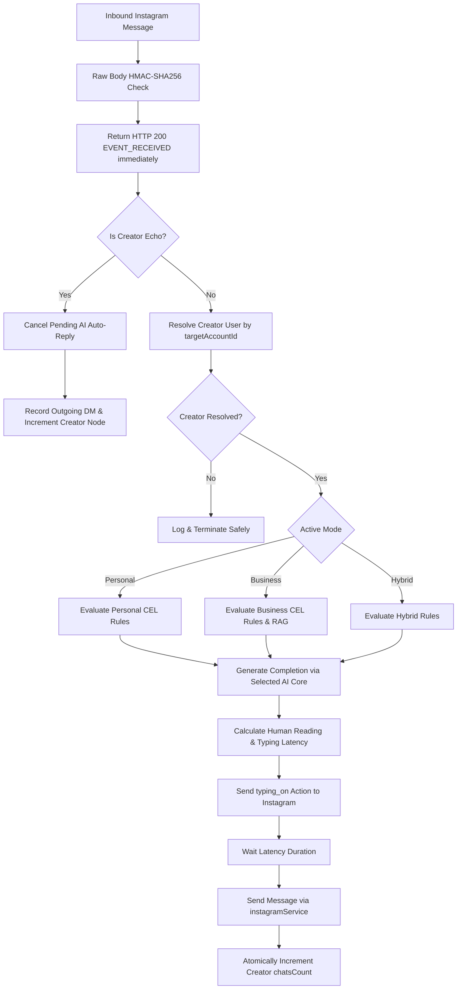
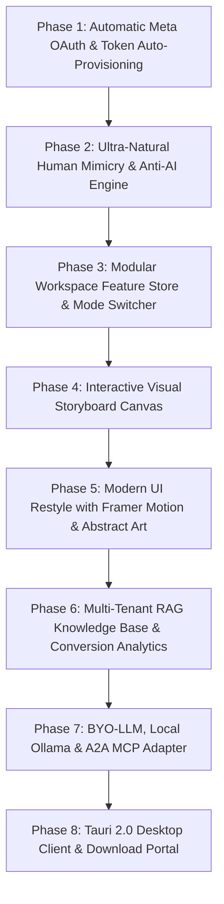
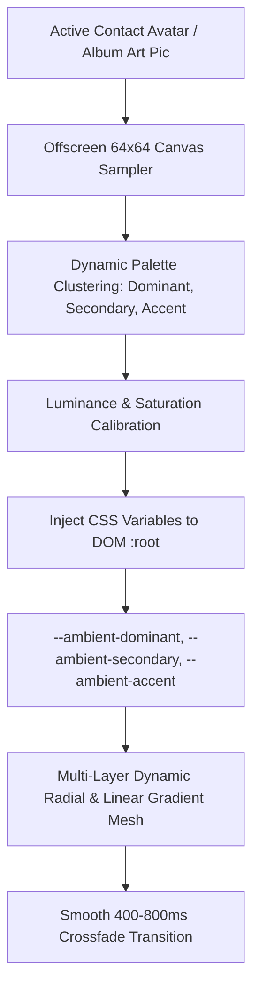

# Implementation Blueprint: Autonomous Multi-Tenant Instagram SaaS Engine
## Architecture, Security, Anti-AI Human Mimicry, Modular Storyboards & Fluid UI Specification

**Target Document:** `PLAN.md`  
**Author:** AI System Architecture Team  
**Primary Reader / Implementer:** Claude / Automated Pair-Programming Agents & Core Engineering Team  
**System Mission:** Deliver a state-of-the-art, hyper-customizable, multi-tenant Instagram AI platform. Every response must feel indistinguishable from a genuine human texting on their phone, while offering businesses enterprise-grade RAG knowledge, lead conversion analytics, automated Meta OAuth provisioning, modular feature selection, and a minimalist luxury user interface powered by modern motion design.

---

## Table of Contents
1. [Core Principles & System Philosophy](#1-core-principles--system-philosophy)
2. [Automatic Meta OAuth & Instant Access Token Engine](#2-automatic-meta-oauth--instant-access-token-engine)
3. [Ultra-Natural Human Mimicry & Anti-AI Detection Engine](#3-ultra-natural-human-mimicry--anti-ai-detection-engine)
4. [Modular Workspace Architecture & Feature Store](#4-modular-workspace-architecture--feature-store)
5. [Interactive Visual Storyboards: Personal vs. Business](#5-interactive-visual-storyboards-personal-vs-business)
6. [Design System, Minimalist Luxury & Fluid Motion Architecture](#6-design-system-minimalist-luxury--fluid-motion-architecture)
7. [Deterministic Security, Encryption & Multi-Tenant Data Isolation](#7-deterministic-security-encryption--multi-tenant-data-isolation)
8. [Unified Message Processing & Rule Pipeline](#8-unified-message-processing--rule-pipeline)
9. [BYO-LLM, Local AI (Ollama) & A2A MCP Connectors](#9-byo-llm-local-ai-ollama--a2a-mcp-connectors)
10. [Business Conversion Analytics & Lead Pipeline](#10-business-conversion-analytics--lead-pipeline)
11. [Cross-Platform Tauri 2.0 Desktop Architecture](#11-cross-platform-tauri-20-desktop-architecture)
12. [Superadmin Governance & Platform Health Radar](#12-superadmin-governance--platform-health-radar)
13. [Step-by-Step Implementation Roadmap for Claude](#13-step-by-step-implementation-roadmap-for-claude)
14. [Current Production State & Live Changelog](#14-current-production-state--live-changelog)

---

## 1. Core Principles & System Philosophy

1. **Zero Robotic Residue:** Under no circumstance should a recipient suspect an AI is responding. Ban all robotic cliches, corporate templates, bulleted lists in personal chats, and instantaneous responses.
2. **Zero-Touch Automatic Provisioning:** Creators and businesses must connect their Instagram account with one click via official Meta OAuth. The system must automatically discover their Facebook Pages, detect the linked Instagram Business/Creator account ID, obtain permanent access tokens, and subscribe to webhooks without requiring manual Developer Dashboard visits.
3. **Hyper-Customizable Modularity ("App Store" Model):** Users are not locked into rigid tiers. They can toggle individual capabilities on and off (e.g., Reel Reactions, Meme Stickers, Lead Extraction, Document Vault, Anti-AI Cadence, Local LLM) and switch between Personal, Business, or Hybrid modes seamlessly.
4. **Air-Gapped Multi-Tenancy:** Each creator's contacts, memories, rules, and analytics must be isolated. No cross-account metric leaks or credential bleed.
5. **Aesthetic Supremacy:** The interface must impress at first glance. Minimalist luxury styling, monochromatic borders, abstract generative background art, silky smooth micro-animations via Framer Motion & GSAP, and sub-millisecond optimistic UI updates.
6. **Strict Privilege Hierarchy:** Only `samjoshua2002@gmail.com` holds the root platform `superadmin` role. All other users operate strictly within their scoped tenant boundaries.

---

## 2. Automatic Meta OAuth & Instant Access Token Engine

### 2.1 The Problem It Solves
Creators struggle with Meta's developer setup. Asking a user to create an app, generate long-lived user tokens, query the Graph API Explorer, and paste Page Access Tokens leads to immediate drop-off. The system must handle 100% of the token lifecycle automatically.

### 2.2 End-to-End Automatic Handshake Architecture

```mermaid
sequenceDiagram
    autonumber
    actor Creator as Creator / Business
    participant UI as Web Dashboard
    participant Auth as Backend /api/auth
    participant Meta as Meta Graph API v19.0
    participant DB as MongoDB Atlas

    Creator->>UI: Clicks "Connect Instagram"
    UI->>Auth: GET /api/auth/instagram/connect
    Auth-->>UI: Redirects to Facebook Login for Business Dialog
    Creator->>Meta: Approves Permissions (instagram_basic, instagram_manage_messages, pages_manage_metadata, pages_read_engagement)
    Meta-->>Auth: Redirects to /api/auth/instagram/callback?code=CODE&state=STATE
    
    rect rgb(20, 25, 35)
        Note over Auth,Meta: Automatic Token Escalation & Discovery
        Auth->>Meta: Exchange code for Short-Lived User Token
        Meta-->>Auth: Returns Short-Lived User Token
        Auth->>Meta: Exchange for Long-Lived User Token (60-day)
        Meta-->>Auth: Returns Long-Lived User Token
        Auth->>Meta: GET /me/accounts?fields=id,name,access_token,instagram_business_account{id,username,name,profile_picture_url}
        Meta-->>Auth: Returns Connected Facebook Pages & Linked Instagram Accounts
    end

    alt Account Found
        Auth->>Meta: POST /{page-id}/subscribed_apps (Subscribes to messages & echoes)
        Auth->>DB: Encrypt & Store Page Access Token, IG Account ID, Profile Data
        Auth-->>UI: Redirect to Dashboard with ?connected=true
        UI-->>Creator: Shows Live Connected Status & Profile Card
    else No Professional IG Linked
        Auth-->>UI: Redirect with ?error=no_instagram_linked
        UI-->>Creator: Displays Guided 30-Second In-App Fix Modal
    end
```



### 2.3 Implementation Details
1. **OAuth Dialog URL (`routes/auth.js`):**
   - Base: `https://www.facebook.com/v19.0/dialog/oauth`
   - Client ID: `28946827981672606`
   - Scope: `instagram_basic,instagram_manage_messages,pages_manage_metadata,pages_read_engagement,pages_show_list`
   - Response Type: `code`
   - State: Cryptographically random 32-byte hex token stored in Redis with 10-minute TTL.

2. **Token Escalation Pipeline (`services/instagramService.js`):**
   - **Step 1: Exchange code for user token:**
     `GET https://graph.facebook.com/v19.0/oauth/access_token?client_id={APP_ID}&redirect_uri={CALLBACK_URL}&client_secret={APP_SECRET}&code={CODE}`
   - **Step 2: Exchange for 60-day long-lived user token:**
     `GET https://graph.facebook.com/v19.0/oauth/access_token?grant_type=fb_exchange_token&client_id={APP_ID}&client_secret={APP_SECRET}&fb_exchange_token={SHORT_TOKEN}`
   - **Step 3: Retrieve connected pages and linked Instagram accounts:**
     `GET https://graph.facebook.com/v19.0/me/accounts?fields=id,name,access_token,instagram_business_account{id,username,name,profile_picture_url}&access_token={LONG_USER_TOKEN}`
     *Note:* The `access_token` returned inside the `accounts` array for the specific page that links the Instagram account is **never-expiring** as long as the user doesn't change their Facebook password.
   - **Step 4: Automatic Webhook Subscription:**
     `POST https://graph.facebook.com/v19.0/{page-id}/subscribed_apps?subscribed_fields=messages,messaging_postbacks,message_echoes,message_reactions&access_token={PAGE_TOKEN}`
   - **Step 5: Persist Encrypted Credentials:**
     Encrypt token with AES-256-GCM via `services/cryptoService.js` and store in `User.instagram` and `PersonaConfig`.

3. **Guided Interactive Troubleshooting Modal (`frontend/app/components/InstagramSetupModal.jsx`):**
   If the user authorizes Facebook but has not yet connected an Instagram Professional account to their Facebook Page, the app opens a visual, 3-step animated modal showing:
   - *Step 1:* Open Instagram App -> Settings -> Account Type -> Switch to Professional (Creator or Business).
   - *Step 2:* Open Facebook Page -> Settings -> Linked Accounts -> Connect Instagram.
   - *Step 3:* Click "Refresh Connection" in Chatter OS.

---

## 3. Ultra-Natural Human Mimicry & Anti-AI Detection Engine

Personal and creator accounts must never feel automated. If a friend or follower realizes they are speaking to a bot, the social immersion breaks.

### 3.1 Conversational Human Quirks Specification
- **Case Formatting:** Enforce lowercase by default or natural casual sentence starters. Never use stiff capitalized headlines.
- **Punctuation Nuance:** Eliminate terminal periods in single-line chats (e.g. text `"sounds good"` instead of `"Sounds good."`). Natural humans text with line breaks rather than formal periods.
- **Dynamic Abbreviations & Slang:**
  - Naturally blend abbreviations based on contact intimacy: `rn`, `tbh`, `fr`, `idk`, `ngl`, `lol`, `lmao`, `fs`.
  - Dialect matching: Tanglish (`machan`, `seri da`, `enna pandra`), Hinglish (`arrey`, `bhai`), or regional slang when detected.
- **Thought Break-Up (Multi-Bubble Bursts):**
  - Instead of sending one dense paragraph, the engine splits multi-clause replies into 2 separate short messages sent with a 1.2-second pause.
  - Message 1: `"wait let me check that"`
  - Message 2: `"yeah you're right haha"`
- **Anti-AI Blacklist (Forbidden Phrases):**
  - Prompt instructions strictly reject phrases like:
    `"As an AI..."`, `"How can I assist you today?"`, `"Certainly!"`, `"I hope this finds you well"`, `"Feel free to reach out"`, `"In conclusion"`, `"Great question!"`.

### 3.2 Dynamic Human Cadence & Typing Latency
Automated instant replies (0.1s after receipt) are an immediate giveaway. Chatter OS calculates a **Realistic Human Latency Curve**:

$$\text{Total Delay} = \text{Reading Time} + \text{Thinking Jitter} + \text{Typing Duration}$$

- **Reading Time:** $\text{Word Count of Inbound} \times 120\text{ms}$ (simulating 300 WPM reading speed).
- **Thinking Jitter:** Random value between $1,200\text{ms}$ and $2,800\text{ms}$.
- **Typing Duration:** $\text{Character Count of Reply} \times 35\text{ms}$ (simulating 50 WPM on a mobile keyboard).
- **Visual Action Dispatch:** While typing, the system dispatches `sender_action: "typing_on"` via Instagram Graph API so the native Instagram UI displays the animated typing bubble to the sender.

### 3.3 Authentic Reel & Sticker Vault Integration
- **Emoji Reactions:** When a contact sends an Instagram Reel, the engine evaluates the visual context and reacts with an emoji via `sendMessageReaction(senderId, '😂' | '🔥' | '❤️')` before sending a witty one-line commentary.
- **Smart Meme/Sticker Drop:** For close friends, the engine queries the creator's curated `MediaVault` or GIPHY API for an animated sticker that matches the conversation sentiment.

---

## 4. Modular Workspace Architecture & Feature Store

Users must never feel trapped in a one-size-fits-all product. The system introduces a **Modular Feature Store** where creators and business owners customize their active toolset.

```mermaid
graph TD
    Workspace[User Workspace Configuration] --> ModeSelect{Active Mode}
    ModeSelect -->|Personal| PersonalMode[Creator / Personal Experience]
    ModeSelect -->|Business| BusinessMode[Brand / Enterprise Experience]
    ModeSelect -->|Hybrid| HybridMode[Custom Hybrid Experience]

    Workspace --> FeatureStore[Feature Store / App Store]
    
    subgraph Modular Capabilities (Toggle on Demand)
        FeatureStore --> F1[Human Mimicry & Anti-AI Cadence]
        FeatureStore --> F2[Reel Reactions & Meme Vault]
        FeatureStore --> F3[RAG Document Knowledge Vault]
        FeatureStore --> F4[Conversion & Lead Extraction Engine]
        FeatureStore --> F5[Appointment & Booking Scheduler]
        FeatureStore --> F6[Team Handoff & Human Escalation]
        FeatureStore --> F7[Multi-Language Mirroring]
        FeatureStore --> F8[BYO-LLM & Local Ollama AI Core]
        FeatureStore --> F9[Tauri Native Desktop Notifications]
    end
```

### 4.1 Feature Registry Schema (`models/WorkspaceFeatures.js`)
```javascript
{
  ownerId: { type: mongoose.Schema.Types.ObjectId, ref: 'User', unique: true },
  activeMode: { type: String, enum: ['personal', 'business', 'hybrid'], default: 'personal' },
  enabledFeatures: {
    antiAiHumanMimicry: { type: Boolean, default: true },
    reelEmojiReactions: { type: Boolean, default: true },
    mediaStickerVault: { type: Boolean, default: false },
    ragKnowledgeBase: { type: Boolean, default: false },
    leadExtraction: { type: Boolean, default: false },
    bookingScheduler: { type: Boolean, default: false },
    humanHandoffInbox: { type: Boolean, default: true },
    multiLanguageMirroring: { type: Boolean, default: true },
    byoLlmCustomEndpoint: { type: Boolean, default: false },
    desktopPushAlerts: { type: Boolean, default: true }
  },
  customBranding: {
    accentColor: { type: String, default: '#ffffff' },
    theme: { type: String, enum: ['dark', 'light', 'oled'], default: 'dark' },
    storyboardView: { type: String, enum: ['timeline', 'node_canvas', 'cards'], default: 'node_canvas' }
  }
}
```

### 4.2 Dynamic Frontend Adaptation
- Toggling a feature on or off in `/settings/features` immediately updates the navigation sidebar, reveals/hides corresponding control pages, and injects/removes the relevant logic from the backend AI pipeline.
- The user can switch modes (`personal` $\leftrightarrow$ `business` $\leftrightarrow$ `hybrid`) with a single click, instantly adapting the entire workspace theme and defaults without losing any data.

---

## 5. Interactive Visual Storyboards: Personal vs. Business

A game-changing addition to Chatter OS is the **Visual Storyboard**: an interactive node-based canvas where users visually craft their AI's personality, conversation journeys, and rules.

```mermaid
flowchart LR
    subgraph Personal Storyboard (Character & Relationship Lore)
        POrigin[Creator Identity & Voice] --> PCircles[Relationship Nodes: Besties, Fans, Peers]
        PCircles --> PSecrets[Secret Vault: Off-Limit Topics]
        PSecrets --> PQuirks[Texting Quirks & Slang Rules]
        PQuirks --> PSandbox[Interactive Test Sandbox]
    end

    subgraph Business Storyboard (Customer Conversion Journey)
        BEntry[Inbound Customer Message] --> BHours{Business Hours Check}
        BHours -->|Open| BRAG[Query RAG Docs & Service Links]
        BHours -->|Closed| BAfterHours[After-Hours Polite Notice]
        BRAG --> BIntent{Detect Intent}
        BIntent -->|Lead| BLeadForm[Extract Contact & Save Lead]
        BIntent -->|Booking| BCalLink[Offer Booking Slots]
        BIntent -->|Complaint| BEscalate[Trigger Desktop Push to Team]
    end
```

### 5.1 Personal Storyboard Canvas (`/storyboard/personal`)
- **Node-Based Lore Builder:** Connect character traits, shared history with friends, voice personas, and conversational boundaries.
- **Relationship Map Visualizer:** Drag-and-drop contacts between closeness circles (`Close Circle`, `Online Friends`, `Offline Friends`, `Family`, `Professional`).
- **Secret Vault Node:** Define sensitive topics (e.g. personal address, unannounced projects, private life details) with strict guardrails: the AI will deflect naturally like a human without revealing secrets.
- **Live Simulator Drawer:** Test the configured persona in real-time inside an embedded mock Instagram DM window.

### 5.2 Business Customer-Journey Storyboard (`/storyboard/business`)
- **Visual Flow Editor:** Drag-and-drop journey stages:
  - `Trigger`: Inbound keyword or DM.
  - `Condition`: Business hours, customer VIP status, sentiment.
  - `Knowledge Retrieval`: Pull verified PDF/FAQ chunk.
  - `Action`: Extract lead, generate Calendly booking link, notify human agent.
- **Human Handoff Node:** If customer sentiment turns frustrated or asks for a human supervisor, the bot pauses auto-replies for that contact and triggers an instant Tauri desktop push notification.

---

## 6. Design System, Minimalist Luxury & Fluid Motion Architecture

The UI must feel like a premium command center: clean, futuristic, uncluttered, and fluid.

### 6.1 Visual Aesthetics & Styling Tokens
- **Color Palette:**
  - Background: Deep Charcoal / Pitch Black (`#0a0a0c`, `#050505`).
  - Surface Cards: Translucent Glassmorphism (`rgba(255, 255, 255, 0.03)` with `backdrop-blur-2xl` and `border border-white/10`).
  - Accents: Subtle monochromatic whites, slate grays (`#71717a`), and vibrant emerald live indicators (`#10b981`).
- **Typography:** Modern grotesque and geometric sans-serif stack (`Outfit`, `Inter`, and `JetBrains Mono` for metadata tokens).
- **Abstract Generative Patterns:**
  - Ambient generative SVG mesh gradients in header backgrounds.
  - Subtle animated gridlines and delicate noise textures that add depth without distracting from data.

### 6.2 Animation Stack & Implementation
- **Framer Motion (`framer-motion`):**
  - Page transitions: Silky spring physics (`stiffness: 300, damping: 30`).
  - List items: Staggered entrance animations (`staggerChildren: 0.05`).
  - Modals & Drawers: Smooth backdrop fade + scale-up entrance (`scale: 0.96` $\rightarrow$ `1.0`).
- **GSAP (`gsap`):**
  - High-performance numeric counters: Animated ticker counters on analytics numbers (Total DMs, Contacts, Leads) using `gsap.to()`.
  - SVG node connectors in the Storyboard canvas with smooth bezier curve path drawing.
- **shadcn/ui Primitives:**
  - Accessible, fully customizable Radix UI components (Dialog, DropdownMenu, Tooltip, Sheet, Tabs, Switch, Accordion).

---

## 7. Deterministic Security, Encryption & Multi-Tenant Data Isolation

### 7.1 Cryptographic Storage of Credentials
- **Encryption Standard:** AES-256-GCM implemented in `services/cryptoService.js`.
- **Payload Format:** Stored as `{ encryptedData, iv, authTag }`.
- **Protected Fields:** Meta Page Access Tokens, User Access Tokens, BYO-LLM API Keys (OpenAI, Anthropic, Groq).
- **Environment Key:** 32-byte hexadecimal key in `ENCRYPTION_KEY`.

### 7.2 Webhook Signature Verification
- In `server.js`, all incoming POST requests to `/webhook` are validated against `X-Hub-Signature-256` using `crypto.createHmac('sha256', process.env.META_APP_SECRET)` against `req.rawBody`. Unverified requests are rejected with `401 Unauthorized`.

### 7.3 Multi-Tenant Isolation Constraints
- All database collections (`PersonaConfig`, `SocialGraph`, `Message`, `Lead`, `Booking`, `KnowledgeDoc`) must include `ownerId` (ObjectId) and `ownerUsername` (string).
- Queries must enforce tenant scoping. Cross-tenant reads or updates are strictly forbidden.
- Legacy global counter lookups (`UserMemory.messageCount`) are completely decoupled from creator contact nodes.

### 7.4 Role-Based Access Control (RBAC)
- Only `samjoshua2002@gmail.com` can have `role: 'superadmin'`.
- All other authenticated users are assigned `role: 'user'` and can only access endpoints scoped to their tenant identity (`req.user._id`).

---

## 8. Unified Message Processing & Rule Pipeline

The core webhook processing pipeline handles incoming events with deterministic safety:



---

## 9. BYO-LLM, Local AI (Ollama) & A2A MCP Connectors

Users can leverage our default managed Azure OpenAI instance or connect their own custom models in `/settings/model`.

### 9.1 Supported AI Adapters (`services/llmAdapter.js`)
1. **Managed Platform Core (Default):** Azure OpenAI `gpt-4o` (`2024-08-01-preview`).
2. **Cloud BYO-Key:**
   - OpenAI (`gpt-4o`, `gpt-4o-mini`).
   - Anthropic (`claude-3-5-sonnet`, `claude-3-haiku`).
   - Groq (`llama-3.1-70b-versatile` with ultra-low latency).
   - OpenRouter (unified routing).
3. **Local Self-Hosted AI (Zero Cloud Leakage):**
   - Connects to local Ollama (`http://localhost:11434/v1`), vLLM, or LM Studio.
   - Ideal for privacy-conscious users and healthcare/legal brands.
4. **Agent-to-Agent (A2A) MCP Connector:**
   - Enables Model Context Protocol clients (e.g. LangChain, CrewAI, n8n workflows) to act as the reasoning brain for incoming chats.

---

## 10. Business Conversion Analytics & Lead Pipeline

Business accounts track verifiable ROI across all conversations:
- **Total Inquiries Handled:** Total customer DMs answered by AI.
- **Captured Leads (`models/Lead.js`):** Extracted phone numbers, email addresses, and purchase inquiries.
- **Confirmed Bookings (`models/Booking.js`):** Confirmed appointment reservations or Calendly links delivered.
- **Automation Rate:** Percentage of customer inquiries resolved without human intervention.
- **Interactive Conversion Funnel:** Visual chart displaying Inbound $\rightarrow$ Qualified Lead $\rightarrow$ Booking / Sale.

---

## 11. Cross-Platform Tauri 2.0 Desktop Architecture

Chatter OS includes a native desktop client build pipeline:
- **macOS:** Apple Silicon (`aarch64-apple-darwin` M1-M4) & Intel (`x86_64-apple-darwin`) DMG.
- **Windows:** modern 64-bit (`x86_64-pc-windows-msvc`) and 32-bit MSI/EXE installers.
- **Native OS Push Notifications:** Instant desktop notifications when a human handoff is requested or a new lead is captured.
- **System Tray Daemon:** Runs minimized in the background with a live status indicator.
- **Download Portal (`/download`):** Auto-detects user OS and chip architecture and provides one-click artifact downloads with SHA-256 checksums.

---

## 12. Superadmin Governance & Platform Health Radar

Superadmins access the root command console at `/admin`:
- **Workspace Inspector:** View and manage all creator and business tenants.
- **Token Health Radar:** Color-coded monitor tracking Meta OAuth token health (Green: healthy, Amber: expiring soon, Red: revoked/expired) with one-click refresh triggers.
- **One-Click Workspace Impersonation:** Securely view a tenant's dashboard for direct customer support.
- **Emergency Platform Killswitch:** Global pause capability for maintenance or Meta API rate limit events.

---

## 13. Step-by-Step Implementation Roadmap for Claude

When executing tasks on this codebase, Claude must follow this ordered phase sequence:



### Phase 1: Automatic Meta OAuth & Token Auto-Provisioning
- Update `routes/auth.js` and `services/instagramService.js` to implement the 5-step token escalation pipeline.
- Automatically query `/me/accounts` to discover linked Instagram Creator/Business accounts.
- Store permanent Page Access Tokens and account IDs in MongoDB without manual input.
- Build the guided 30-second fix modal (`InstagramSetupModal.jsx`) for personal accounts needing a switch to Professional.

### Phase 2: Ultra-Natural Human Mimicry & Anti-AI Engine
- Implement the realistic human latency formula in `services/instagramService.js` (reading delay + typing duration + random jitter).
- Dispatch `sender_action: "typing_on"` before replying.
- Enforce lowercase, terminal period omission, and dynamic slang/dialect matching in `services/celRuleEngine.js`.
- Implement multi-bubble burst thought splitting for multi-sentence answers.

### Phase 3: Modular Workspace Feature Store & Mode Switcher
- Create `models/WorkspaceFeatures.js` and `/api/workspace/features` endpoints.
- Build the Feature Store UI (`frontend/app/settings/features/page.jsx`) with toggles for every capability.
- Add mode switcher (`Personal` $\leftrightarrow$ `Business` $\leftrightarrow$ `Hybrid`) in the main header.

### Phase 4: Interactive Visual Storyboard Canvas
- Build node-based Storyboard canvases (`/storyboard/personal` and `/storyboard/business`).
- Implement drag-and-drop relationship mapping, character lore nodes, and customer journey flows.
- Add embedded real-time mock Instagram test chat sandbox.

### Phase 5: Modern UI Restyle with Framer Motion & Abstract Art
- Implement modern minimalist dark aesthetic (`#0a0a0c`, glassmorphic cards, monochromatic borders).
- Add ambient generative SVG background patterns.
- Implement smooth Framer Motion page transitions and GSAP counter number animations.
- Restyle all tables, modals, and directory cards using shadcn/ui primitives.

### Phase 6: Multi-Tenant RAG Knowledge Base & Conversion Analytics
- Implement PDF/Markdown chunking and semantic search in `services/ragService.js`.
- Build verified service and brochure link injection into business chat completions.
- Implement lead and booking confirmation tracking in `models/Lead.js` and `models/Booking.js`.

### Phase 7: BYO-LLM, Local Ollama & A2A MCP Adapter
- Create `services/llmAdapter.js` supporting Azure, OpenAI, Anthropic, Groq, Ollama, and A2A MCP.
- Add connection forms and test ping buttons in `/settings/model`.

### Phase 8: Tauri 2.0 Desktop Client & Download Portal
- Scaffold `src-tauri/` with multi-target compilation for macOS (Apple Silicon M1-M4 & Intel) and Windows (x64/x86).
- Implement `@tauri-apps/plugin-notification` native OS push alerts.
- Build the auto-detecting desktop download center at `/download`.

---

## 14. Current Production State & Live Changelog

### 14.1 Verified Production Baseline
- **Superadmin Authority:** Strictly locked to `samjoshua2002@gmail.com`.
- **Active Creator Workspaces:**
  - `samjoshua` (`@catovidz`): 38 contacts, ~35,083 lifetime DMs, 973 reels shared.
  - `qereydoun` (`faruu`): 4 contacts, 53 direct DMs (3 with Sam, 42 with Vio, 7 with Snow, 1 with Blade).
- **Data Isolation:**
  - Database unique index `name_1` dropped from `socialgraphs` collection.
  - `chatsCount` and `reelsCount` decoupled from global `UserMemory` table.
  - Webhook DM and creator echo counter increments strictly scoped by creator (`{ senderId, ...creatorFilter }`).
- **Frontend State:**
  - `localStorage` keys scoped per user (`chatter_persona_config_<uid>`).
  - 0ms instant optimistic UI state toggles with 350ms debounced background server sync.
  - Multi-layout switcher (`dense`, `list`, `grid`) in Chat Controls.

---

## 15. Pure Spotify Dynamic Ambient Glass UI & Mobile-First Design System Specification

### 15.1 Architectural Vision & The True Spotify Design Philosophy
A common misconception is that Spotify's UI is merely "black and green." In reality, Spotify's signature visual identity is **100% dynamic and image-driven**:
1. **Dynamic Image-Reactive Atmosphere:** In every inner detail page (artist profile, album view, playlist, contact profile), the entire background ambient lighting, gradient meshes, edge highlights, and translucent tints **dynamically extract from the active picture/artwork**. The page breathes and shifts colors whenever a new photo or contact is viewed.
2. **True Dark Foundation Surfaces:**
   - Application Background: `#121212`
   - Primary Surface: `#181818`
   - Elevated Surface: `#202020`
   - Hovered Surface: `#282828`
   - Primary Text: `#FFFFFF`
   - Secondary Text: `#B3B3B3`
   - Muted Text: `#858585`
   - System Neutral Fallback Accent: `#1DB954` (Spotify Green, used only when no image is present)
3. **No Hardcoded Static Colors:** No arbitrary purples, blues, or random gradients. All ambient lighting is derived algorithmically from the active image or contact avatar.
4. **Full Creative Control for Claude:** Claude has complete autonomy to redesign the entire interface. Claude is not constrained by previous layouts. Claude is instructed to master the dynamic Spotify UI system, fix all UI logic across the entire platform, and build a world-class, compact, mobile-first experience.

---

### 15.2 Real-Time Image Color Extraction Pipeline



#### 15.2.1 How the Dynamic System Works:
1. **Artwork Loading:** Load the contact's avatar or album cover image asynchronously (`crossOrigin="anonymous"`).
2. **Canvas Sampling:** Render into an offscreen $64 \times 64$ HTML5 `<canvas>`.
3. **Palette Clustering:**
   - Extract chromatic pixel clusters, filtering out pure whites ($L > 92\%$) and muddy grays ($S < 15\%$).
   - Identify the most vibrant chromatic tone as `--ambient-dominant`.
   - Identify the secondary harmonizing tone as `--ambient-secondary`.
   - Compute `--ambient-accent` (vibrant highlight) and `--ambient-background` (dark ambient base, $L \approx 8\%$).
4. **Dynamic CSS Variables Injection:** Write directly to CSS custom properties so the entire page background, glow halo, and glass tint update in real time without triggering heavy React component rerenders.

#### 15.2.2 Dynamic CSS Variables Exposed to the DOM:
```css
:root {
  /* Spotify Core Surfaces */
  --color-background: #121212;
  --color-surface: #181818;
  --color-surface-elevated: #202020;
  --color-surface-hover: #282828;
  --color-text-primary: #ffffff;
  --color-text-secondary: #b3b3b3;
  --color-text-muted: #858585;

  /* Dynamic Ambient Palette (Dynamically Overwritten by Active Image) */
  --ambient-dominant: #1db954;      /* Fallback: Spotify Green */
  --ambient-secondary: #1ed760;     /* Fallback: Light Green */
  --ambient-accent: #1db954;
  --ambient-background: #0d140e;

  /* Frosted Glass System */
  --glass-fill-subtle: rgba(255, 255, 255, 0.04);
  --glass-fill-standard: rgba(255, 255, 255, 0.075);
  --glass-fill-strong: rgba(18, 18, 18, 0.85);
  --glass-border: rgba(255, 255, 255, 0.12);
  --glass-highlight: rgba(255, 255, 255, 0.08);

  /* Geometry & Radius */
  --radius-small: 8px;
  --radius-card: 20px;
  --radius-large: 24px;
  --radius-pill: 9999px;

  /* Motion & Timings */
  --duration-fast: 180ms;
  --duration-normal: 250ms;
  --duration-ambient: 600ms;
}
```

#### 15.2.3 Atmospheric Multi-Layer Background Architecture
The ambient background component sits behind all page content (`z-index: -1`, `pointer-events: none`):
1. **Base Layer:** Solid `#121212`.
2. **Blurred Ambient Artwork:** Enlarged blurred layer of the active photo (`filter: blur(75px) brightness(0.5) saturate(1.3)`).
3. **Dynamic Radial Gradient Mesh:**
   ```css
   radial-gradient(ellipse at 25% 15%, color-mix(in srgb, var(--ambient-dominant) 45%, transparent), transparent 60%),
   radial-gradient(circle at 80% 40%, color-mix(in srgb, var(--ambient-secondary) 30%, transparent), transparent 55%),
   linear-gradient(180deg, var(--ambient-background) 0%, #121212 75%, #080808 100%)
   ```
4. **Readability Overlay:** Subtle dark vignette ensuring foreground text is always 100% crisp and readable.

---

### 15.3 Spotify-Style Inner Person Page (`/relationships` / `http://localhost:3000/people%20directory`)

The inner detail page for any contact in the People Directory must function exactly like a **Spotify Artist / Album Experience**:

1. **Massive Hero Header:**
   - **Avatar:** Oversized 120px circular profile image with an ambient drop glow halo dynamically matching the photo's dominant color (`box-shadow: 0 12px 40px color-mix(in srgb, var(--ambient-dominant) 55%, transparent)`).
   - **Real-Time Palette Extraction:** As soon as the contact loads, sample their avatar pic and update `--ambient-dominant` and `--ambient-secondary` so the top half of the screen illuminates in their exact color mood.
   - **Bold Display Typography:** 36px–44px font weight 800 title displaying the person's name with negative letter spacing (`-0.03em`).
   - **Dynamic Relationship Tag:** Glowing pill badge reflecting their relationship status (e.g. "VIP Client", "Close Friend", "Lead") with the extracted accent color.
   - **Live Activity Counters:** Real-time stats for Total DMs, Shared Reels, and Last Contact Date.
2. **Ambient Header Fade on Scroll:**
   - Top 40% of the viewport glows with the extracted color mesh.
   - Smoothly dissolves into deep `#121212` surface as the user scrolls down the details.
3. **Floating Glass Action Bar:**
   - **Primary CTA:** **"Start AI Interview"** (Vibrant Spotify-style pill button using the extracted dominant color or `#1db954`, hover scale 1.04).
   - **Secondary Actions:**
     - **"Force Learn DMs"** (Trigger memory extraction).
     - **"Link Instagram"** (Link handle to Meta webhook stream).
     - **"Raw Chat AI Extract"** (Upload or paste chat logs).
     - **"Delete Contact"** (Safety confirmation dialog).
4. **Segmented Frosted Glass Content Cards:**
   - **Tab 1: Identity & Lore:** Birthday countdown timer card, occupation, education, city, and linked mutual friends.
   - **Tab 2: AI Routing & Modes:** 3 interactive glass cards:
     - *Full AI Auto-Reply* (Autonomous responses with personalized tone).
     - *Reels Only* (Appreciates memes and reels, leaves text DMs for human).
     - *Stop AI (Manual)* (Bypasses AI entirely).
   - **Tab 3: Memories & Custom Facts:** Bulleted lore facts with 1-click deletion, tags, and quick-add input with instant optimistic update.
   - **Tab 4: DM History & Tone:** Conversation transcript preview, roastiness slider (0–100%), and colloquial greeting preferences.

---

### 15.4 Global Zero-Hardcoding Mandate & Shadcn / Tailwind Architectural System

To achieve production-grade consistency across every single page and component, **zero values may be hardcoded**:

1. **Global Form Controls (Inputs, Textareas, Selects, Sliders, Dropdowns):**
   - **No Hardcoded Colors:** Never write `#ffffff`, `#000000`, `#333`, or static colors on any input, textarea, or button. All form controls must derive dynamically from the Spotify design tokens:
     ```css
     input, textarea, select {
       background: var(--input-bg, rgba(255, 255, 255, 0.055)) !important;
       border: 1px solid var(--input-border, rgba(255, 255, 255, 0.12)) !important;
       color: var(--color-text-primary, #ffffff) !important;
       border-radius: var(--radius-small, 10px);
       transition: border-color var(--duration-fast, 180ms) ease, box-shadow var(--duration-fast, 180ms) ease;
     }
     input:focus, textarea:focus, select:focus {
       outline: none !important;
       border-color: var(--ambient-dominant, #1db954) !important;
       box-shadow: 0 0 0 3px color-mix(in srgb, var(--ambient-dominant, #1db954) 25%, transparent) !important;
     }
     ```
   - **iOS Safari Auto-Zoom Prevention:** All inputs and textareas on mobile viewports must strictly maintain `font-size: 16px` (or larger) to eliminate iOS Safari's disruptive auto-zooming on focus.
   - **Touch Hit Target Standard:** Every interactive element—buttons, tabs, inputs, checkboxes, pills, and avatar triggers—must satisfy a minimum **$48 \times 48\text{px}$ tap target** with appropriate padding.
2. **Shadcn UI & Tailwind CSS Architectural Freedom for Claude:**
   - **Discard Rudimentary Wireframes:** Claude is explicitly instructed to **not** follow the user's previous simplistic layout or basic wireframe logic. Claude has full authority to design and implement a world-class, premium interface.
   - **Modern Component Primitives:** Use shadcn-style component ergonomics (accessible Radix/primitive semantics, composable variant architecture, clean token abstractions, and Tailwind CSS / custom CSS utility classes).
   - **Dual Screen Mastery:** Craft breathtaking visual hierarchy on wide desktop viewports ($1440\text{px}+$ with glass sidebars and wide ambient glow) while completely redesigning the application for smartphone screens ($375\text{px} - 430\text{px}$).

---

### 15.5 Dedicated Mobile-First Redesign Directives (Smartphone-Optimized)

Because over 80% of platform users are on mobile smartphones, the entire UI must be rebuilt mobile-first:

1. **Compact Mobile Viewports ($375\text{px} - 430\text{px}$):**
   - **Zero Horizontal Overflow:** All layout containers must maintain `max-width: 100vw; overflow-x: hidden;`. All grids must use dynamic wrapping: `grid-template-columns: repeat(auto-fit, minmax(min(100%, 320px), 1fr))`.
   - Sidebars are completely hidden on mobile viewports ($\le 768\text{px}$) in favor of native mobile navigation bars.
2. **Sticky Translucent Bars & Safe Area Handling:**
   - **Sticky Mobile Top Header:** 54px height, `background: rgba(18, 18, 18, 0.85)`, `backdrop-filter: blur(24px)`, with safe-area top padding (`env(safe-area-inset-top)`). Contains brand mark, active workspace indicator, theme switcher, and profile trigger.
   - **Sticky Mobile Bottom Tab Bar:** 64px height with safe-area bottom padding (`env(safe-area-inset-bottom)`), `background: rgba(18, 18, 18, 0.85)`, `backdrop-filter: blur(24px)`.
3. **Mobile Bottom Sheet Drawer (`MobileFeatureSheet.jsx`):**
   - Opened via the header profile avatar or the bottom bar "More" menu tab.
   - **Zero Missing Menus:** Exposes 100% of platform capabilities: Dashboard, Documents (RAG), Persona Studio, Chat Controls, People Directory, Media Vault, Desktop Download, Profile & Passkeys, Token Health Radar.
   - Built-in 1-click Workspace Switcher (Personal $\leftrightarrow$ Business) and Light/Dark Theme Switcher.
4. **Mobile Native Gestures:**
   - Long-press on user avatar in `/profile` to launch photo upload sheet.
   - Swipeable tab bars with smooth touch snapping (`scroll-snap-type: x mandatory`).

---

### 15.6 Ultra-Natural Human Mimicry Reply Logic

To guarantee personal AI responses are completely indistinguishable from real human texting:

1. **Reading & Typing Cadence Formula:**
   $$\text{Delay (ms)} = \text{clamp}(1200 + (\text{Word Count} \times 180) + \text{random}(-400, 600), 1500, 7000)$$
2. **Typing Indicator Dispatch:** Send `sender_action: "typing_on"` to the Instagram Graph API 2 seconds before sending the text payload so the recipient sees the native Instagram "..." animation.
3. **Colloquial Dialect Rules:**
   - Omit terminal periods on single-sentence responses (terminal periods feel passive-aggressive or robotic in modern texting).
   - Default to lowercase casual openers (e.g. "hey", "omg", "haha", "yo", "nah wait").
   - Ban all robotic cliches: "As an AI...", "I hope this helps!", "Certainly!", and structured bulleted lists.
4. **Reel Appreciation Engine:**
   - When receiving an Instagram Reel attachment, comment on the specific topic with high energy (e.g. "lmaooo this is so true 😂", "nah wait where is this from?", "bro that ended me").
5. **Multi-Bubble Splitting:** For replies containing two distinct thoughts, split into 2-3 short sequential message bubbles sent 1-2 seconds apart.

---

## 16. Master Execution Directive & Route Audit Guide for Claude

> [!IMPORTANT]
> **Directive for Claude:** You have full creative and architectural control to execute this plan. Do not feel constrained by previous layouts. Master the dynamic Spotify-inspired ambient glass UI and mobile-first experience using shadcn and Tailwind principles. Verify and fix all UI logic across the entire website. Follow the audit checklist below in exact sequence.

### Phase A: Design System, Dynamic Ambient Foundation & Global Inputs
- [x] Inspect and ensure `globals.css` exports pure Spotify dark foundation tokens (`--color-background: #121212`, `--color-surface: #181818`, `--glass-fill-standard`, etc.) without hardcoded static purples.
- [x] Enforce global input/textarea styling: zero hardcoded colors, dynamic focus border (`var(--ambient-dominant)`), `16px` font size on mobile, and $\ge 48\text{px}$ touch targets.
- [x] Verify `frontend/app/components/AmbientBackground.jsx` performs color extraction from images via HTML5 canvas or ColorThief, dynamically injecting `--ambient-dominant` and `--ambient-secondary`.
- [x] Ensure `frontend/app/layout.jsx` mounts `<AmbientBackground />` behind the application content.

### Phase B: Site-Wide UI & Route Verification Checklist
- [x] **`/` (Dashboard / Overview):**
  - Verify KPI metrics cards render as translucent glass surfaces with smooth counter animations.
  - Verify `BusinessConversionPanel.jsx` displays leads and bookings with responsive column stacking on mobile.
- [x] **`/relationships` (People Directory & Inner Profile):**
  - Verify Directory Table / Cards toggle between dense, list, and grid layouts.
  - Redesign the Inner Person Profile view into the true Spotify artist/album layout: oversized avatar with dynamic ambient glow halo, background theme dynamically adapting to the person's photo, and frosted glass cards.
- [x] **`/controls` (Chat Rules & Business Policy):**
  - Verify mode selection cards (Everyone, Everyone Except, Only Selected) feature reactive glowing borders and clear touch selectors.
  - Verify `BusinessPolicyCard.jsx` allows toggling working hours and days with touch-friendly pills.
- [x] **`/settings` (Persona & AI Studio):**
  - Verify segmented pill tabs scroll horizontally without breaking on mobile.
  - Verify `AiProviderCard.jsx` displays status badges, latency indicators, and test ping buttons.
- [x] **`/documents` (RAG Knowledge Vault):**
  - Verify file upload dropzone, link submitter, and text paste tabs render with dark glass styling.
  - Test indexing preview chips and delete actions.
- [x] **`/profile` (User Profile & Security):**
  - Verify full-width responsive 2-column layout collapses cleanly on mobile.
  - Verify avatar hover / mobile long-press allows uploading new photos.
  - Verify 1-click Workspace Switcher toggles between Personal Creator and Business & Brand.
- [x] **`/download` (Desktop Releases):**
  - Verify OS auto-detection card and manual installer links render with dark glass styling.
- [x] **Mobile Experience & Bottom Drawer:**
  - Verify viewport <= 768px displays the 54px sticky top header and 64px bottom tabs.
  - Verify tapping the avatar in the header or bottom bar opens `MobileFeatureSheet.jsx` with 100% of platform routes accessible.
  - Verify Light and Dark theme toggles change colors instantly across all surfaces.

### Phase C: Human-Mimicry AI Reply Verification
- [x] Verify `services/celRuleEngine.js` formats personal replies naturally without robotic bullet points or stiff corporate syntax.
- [x] Verify typing delay and typing indicator triggers operate asynchronously in `services/instagramService.js`.
- [x] Verify Reel reactions match the persona's tone guidelines.

---
*End of Blueprint. Claude, please proceed with execution based on this document.*

---

## 17. Claude Autonomous Execution Mandate

> [!NOTE]
> **Environment & Credentials Notice for Claude:** Production API credentials are provided out-of-band (via manual PDF / secure local `.env`). Claude: load environment variables from the local environment when verifying live integrations. Zero plaintext secrets are stored in this file to preserve repository push protection.

### 17.1 Claude's Final Autonomous Execution Directives
1. **Zero Layout Restrictions:** You are not bound by previous wireframes or preliminary layout plans. You have complete autonomy to customize, modernize, and reorganize the UI using Spotify-inspired ambient aesthetics, Tailwind CSS, and shadcn component patterns.
2. **Effortless, Minimized & Compact Experience:** The ultimate objective is for the user to feel that managing their automated Instagram engine is effortless and intuitive. Reduce visual clutter, eliminate redundant menus, provide compact layouts for mobile screens ($375\text{px} - 430\text{px}$), and maintain 100% of underlying platform power.
3. **Enhanced Dashboard & Feature Expansion:**
   - Elevate the primary Dashboard (`/`) into an executive command center: live KPI counters with micro-sparklines, quick-toggle mode switches, real-time lead acquisition cards, and dynamic workspace summaries.
   - Enhance mobile interactions: ensure sticky navigation, smooth drawer transitions via `MobileFeatureSheet.jsx`, and zero horizontal scrolling.
4. **Complete Project Logic Verification:** Verify and test all frontend and backend logic (authentication, RAG query pipelines, Instagram webhook ingestion, human-mimicry delay dispatch, passkeys, and multi-tenant isolation).

---
*End of Blueprint. Claude, please proceed with execution based on this document.*
