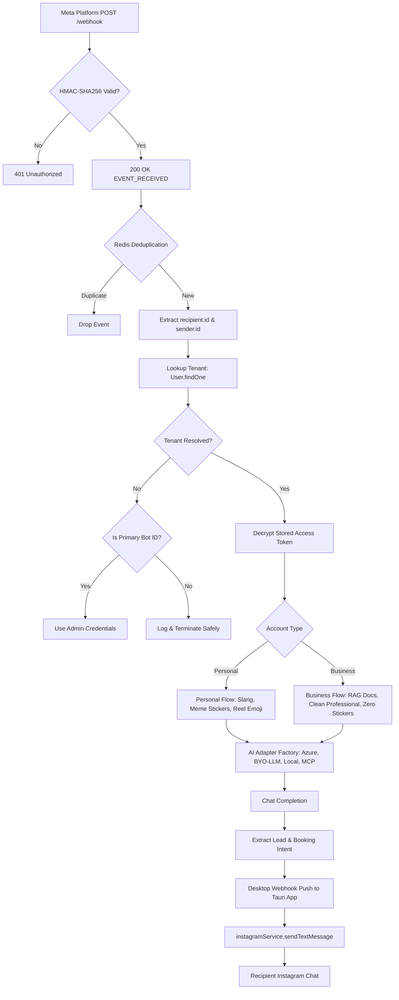
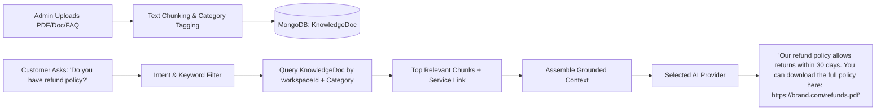
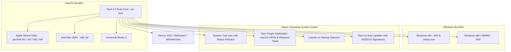
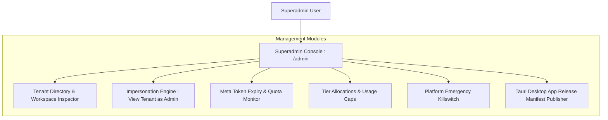
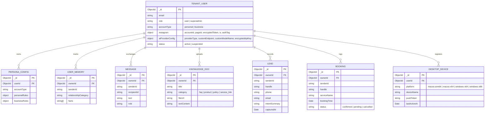

# Implementation Blueprint: Multi-Tenant SaaS Architecture for Instagram AI Auto-Reply

**Target Document:** `PLAN.md`  
**Purpose:** Actionable, phased architectural specification for Claude to implement multi-tenancy, Facebook Login for Business OAuth, dual CEL rule engines (Personal vs. Business), dynamic RAG knowledge base for business, authentic human-mimicry styling for personal accounts, custom BYO-LLM / Local AI / A2A MCP connector integrations, multi-language translation, business analytics (Leads & Booking metrics), desktop ecosystem deployment with Tauri 2.0 (macOS Apple Silicon M1-M4 & Intel DMG, Windows x64/x86 MSI/EXE) with native desktop push notifications, a dedicated cross-platform download portal, and an expanded Superadmin Control Console.  
**Operating Principle:** Preserve the current working Instagram integration while cleanly isolating external user accounts.

---

## 1. Project Overview

The project is an autonomous Instagram Direct Message assistant currently operating in production for a single primary account.
- **Backend:** Node.js (v18+) with Express 4.18.2 hosted on Render (`https://instagram-ai-bot-64tf.onrender.com`).
- **Web Frontend:** Next.js 14.2.3 (App Router), React 18, and TailwindCSS hosted on Vercel (`https://instagram-ebon-zeta.vercel.app`).
- **Desktop Client Framework (Planned):** Tauri 2.0 (Rust core + Next.js frontend build) with system tray, background daemon, and native OS push notifications.
- **Database & Cache:** MongoDB Atlas via Mongoose 8.3.1, Upstash Redis via `ioredis`.
- **Default AI Core:** Azure OpenAI `gpt-4o` (`2024-08-01-preview`) via `@openai/openai` AzureOpenAI client.
- **Rule Engine:** Google Common Expression Language via `@marcbachmann/cel-js`.
- **Authentication:** JWT, BCrypt, WebAuthn (Passkeys via `@simplewebauthn`), and SMTP OTP via Nodemailer.

---

## 2. Product Vision and Goals

Transition from a single-tenant bot into a scalable multi-user SaaS platform supporting two distinct tier experiences with custom AI models, business analytics, and a native desktop app:

```mermaid
graph TD
    User([Customer / Client]) --> Reg[Register & Verify Email]
    Reg --> SelectType{Account Type Selection}
    SelectType -->|Individual / Creator| PersonalFlow[Personal AI Assistant]
    SelectType -->|Company / Brand| BusinessFlow[Business AI Assistant]
    
    subgraph Personal Tier (Human Mimicry & Social Connection)
        PersonalFlow --> P1[Personal Bio, Texting Habits & Lore]
        P1 --> P2[Personal CEL Rules: Casual, Tanglish, Slang, Banter]
        P2 --> P3[Reel Reactions & Sticker Vaults: GIPHY + Custom]
        P3 --> P4[Connect Instagram Professional via OAuth]
    end
    
    subgraph Business Tier (RAG Knowledge, Conversions & Compliance)
        BusinessFlow --> B1[Company Knowledge: Runbooks, FAQs, Pricing]
        B1 --> B2[Dynamic Sidebar: Attachments & Service Docs]
        B2 --> B3[RAG Engine: Semantic Chunking & Grounded Answers]
        B3 --> B4[Conversion Tracking: Leads, Bookings & Sentiment]
        B4 --> B5[Business CEL Rules: Hours, Escalation, Zero-Stickers]
        B5 --> B6[Connect Instagram Business via OAuth]
    end
    
    subgraph Modular AI Engine (Default or BYO-LLM)
        ModularAI{Select AI Engine}
        ModularAI -->|Default| PlatformAzure[Platform Azure OpenAI gpt-4o]
        ModularAI -->|Custom Cloud| UserOpenAI[Custom OpenAI / Anthropic / Groq / OpenRouter]
        ModularAI -->|Self-Hosted / Local| LocalOllama[Local LLM: Ollama / vLLM / LMStudio]
        ModularAI -->|Agent-to-Agent| MCPA2A[A2A MCP Protocol Connector]
    end
    
    subgraph Multi-Platform Desktop & Web Ecosystem
        P4 --> MultiPlatform[Cross-Platform Client]
        B6 --> MultiPlatform
        MultiPlatform --> WebPWA[Next.js Web Dashboard]
        MultiPlatform --> TauriDesktop[Tauri 2.0 Desktop Apps]
        TauriDesktop --> MacApp[macOS DMG: Apple Silicon M1-M4 & Intel x86_64]
        TauriDesktop --> WinApp[Windows Installer: x64 & x86 MSI/EXE]
        TauriDesktop --> PushNotif[Native OS Push Notifications & System Tray]
    end
```

### Personal Experience (Human Mimicry & Authentic Texting)
1. **Self-Serve Registration:** Sign up with email OTP or biometric Passkey.
2. **Persona & Writing Habits:** Define texting habits (all lowercase, no stiff periods, relaxed abbreviations like `rn`, `u`, `tbh`, `fr`, quick natural banter).
3. **Reel Reactions & Media Vault:** Interactive emoji reactions on reel shares (e.g. laughing reaction `😂`), animated GIF stickers via GIPHY, and meme image drops exclusively for personal accounts.
4. **Anti-AI Sounding Directives:** System prompts strictly forbid robotic cliches ("How can I help you today?", "As an AI model", "Certainly!").
5. **One-Click Connect:** Connect Instagram via official Meta OAuth without visiting Meta Developer Dashboard.

### Business Experience (RAG Knowledge, Conversion Analytics & Human Handoff)
1. **Business Sidebar Navigation:** Automatically reveals dedicated business menus: **Document Vault**, **Knowledge RAG**, **Team Handoff Inbox**, **Service Catalog**, and **Analytics Dashboard**.
2. **Dynamic Knowledge & Document Sharing:** Upload PDF/Markdown runbooks, product sheets, pricing guides, and support FAQs. When customer DMs ask for specifications, brochures, or policies, the bot provides precise grounded answers and delivers official document download links.
3. **Leads & Booking Analytics:**
   - **Tracked Leads:** Automatically categorizes conversations when a user shares their phone number, email, or asks for product demos/pricing.
   - **Booking Confirmations:** Tracks confirmed appointments, reservations, or Calendly link clicks directly inside the business dashboard.
4. **No Stickers or Gimmicks:** Fancy reel reactions, random meme stickers, and slang are strictly stripped from business accounts to maintain enterprise brand prestige.
5. **Business CEL Rules:** Deterministic business hours enforcement, customer complaint escalation, human handoff triggers, and refund limits.

---

## 3. Current Architecture and Codebase Findings

### 3.1 Hardcoded Account References
- In `server.js:L267` and `server.js:L371`:
  ```javascript
  const botAccountId = process.env.INSTAGRAM_ACCOUNT_ID || '17841446877896232';
  if (accountId && accountId !== botAccountId && recipientId !== botAccountId) {
    console.log(`⏸️ Skipping: event is for account ${accountId || recipientId}...`);
    return;
  }
  ```
  *Finding [Verified]:* Incoming messages are discarded if they do not match `process.env.INSTAGRAM_ACCOUNT_ID`.
- In `services/instagramService.js:L40-L65`:
  `getAccessToken()` and `getAccountId()` query `PersonaConfig.findOne()` or fall back to `process.env.INSTAGRAM_PAGE_ACCESS_TOKEN`.
- `sendSenderAction()`, `sendMessageReaction()`, and `getUserProfile()` in `services/instagramService.js` call `getAccessToken()` internally without accepting a dynamic token parameter. Only `sendTextMessage()` and `sendImageMessage()` have optional `customToken` parameters.

### 3.2 Singleton Models
- `PersonaConfig.findOne()` is invoked in `server.js:L409`, `server.js:L1075`, and `services/instagramService.js:L42`. There is no `userId` index enforcing single configurations per tenant.
- `Message` records (`models/Message.js`) store `senderId` and `recipientId` without an `ownerId` or `workspaceId` field.

### 3.3 Rule Engine (`services/celRuleEngine.js`)
- Uses `@marcbachmann/cel-js`.
- Evaluates four hardcoded CEL rules:
  1. `STYLE_MODE_RULE`: Maps slang, gender, and relationship to modes (`tanglish_homie`, `sweet_playful`, `guy_banter`, `chill_creator`, `casual_peer`).
  2. `FACT_GATING_RULE`: Boolean gate for injecting biographical memories.
  3. `LENGTH_TIER_RULE`: Maps word counts and reel shares to `ultra_short`, `one_liner`, or `short_burst`.
  4. `MODEL_ROUTING_RULE`: Dynamically chooses model tier based on complexity.
- *Finding [Verified]:* Rules are currently static strings inside the class constructor and cannot be altered per user without modifying code.

---

## 4. Existing Limitations and Risks

| Area | Current Implementation | Multi-Tenant Risk | Remediation Required |
| :--- | :--- | :--- | :--- |
| **Token Storage** | Plaintext in `PersonaConfig` and `User` | High: Database breach exposes all Instagram tokens | AES-256-GCM encryption at rest |
| **Webhook Validation** | Checks `hub.verify_token` on GET; no HMAC check on POST | Inbound event forgery via unauthenticated POST | Validate `X-Hub-Signature-256` using App Secret |
| **Tenant Routing** | Hardcoded filter for `17841446877896232` | Drops events for all other accounts | Dynamic lookup: `User.findOne({ "instagram.accountId": recipientId })` |
| **Fallback Token** | Falls back to `.env` token | Critical: Cross-replying through admin account on foreign events | Safe failure: Drop message if account unresolvable |
| **AI Provider** | Hardcoded Azure OpenAI global instance | All tenants share platform Azure quota and costs | Support custom BYO-LLM, Local Ollama, and A2A MCP |
| **Sticker Dispatch** | Global sticker vault trigger | Business accounts could send meme stickers to clients | Gated by `accountType === 'personal'` |
| **CEL Engine** | Single set of personal slang rules in memory | Business accounts would reply with personal slang | Shared evaluator with separate schemas & policy banks |

---

## 5. Verified Meta API Integration Strategy

### 5.1 Authentication Flow Comparison
1. **Instagram Login for Creators (Consumer OAuth):**
   - Endpoints: `api.instagram.com/oauth/authorize`.
   - Returns Instagram User Access Token (`IG...`).
   - *Limitation:* Does not automatically yield page metadata or support Facebook Page webhooks seamlessly without additional permissions.
2. **Facebook Login for Business (Recommended) [Verified]:**
   - Endpoints: `www.facebook.com/v19.0/dialog/oauth`.
   - Flow: User authorizes with their Facebook identity managing the Instagram Professional account.
   - Provides:
     - Long-lived User Token exchanged via `oauth/access_token`.
     - Connected Facebook Pages (`GET /me/accounts`).
     - Linked Instagram Business ID (`GET /{page-id}?fields=instagram_business_account`).
     - Permanent Page Access Token for `graph.facebook.com/v19.0/{page-id}/messages`.
     - Automatic webhook subscription via `POST /{page-id}/subscribed_apps`.

### 5.2 Required Permissions & Scope
- `instagram_basic`
- `instagram_manage_messages`
- `pages_manage_metadata`
- `pages_read_engagement`
- `business_management` (optional, for enterprise assets)

### 5.3 Official Documentation References
- Meta Instagram Graph API Overview: `https://developers.facebook.com/docs/instagram-platform/instagram-graph-api`
- Instagram Messaging Setup: `https://developers.facebook.com/docs/messenger-platform/instagram/get-started`
- Webhook Subscriptions: `https://developers.facebook.com/docs/graph-api/webhooks/getting-started`
- Access Token Handling: `https://developers.facebook.com/docs/facebook-login/guides/access-tokens`

---

## 6. Target Multi-Tenant Architecture



---

## 7. Personal vs. Business Product Separation

### 7.1 Architecture Comparison Matrix

| Capability | Personal Assistant | Business Assistant | Superadmin Console |
| :--- | :--- | :--- | :--- |
| **Target User** | Content creator, influencer, individual | Company, brand, e-commerce, clinic | Platform Owner, Root System Admin |
| **Tone & Style** | Real friend texting, Tanglish, witty banter | Crisp, polite, professional, brand-compliant | System audit logs, platform diagnostics |
| **Human Mimicry** | Lowercase, no ending periods, slang shortcuts (`rn`, `tbh`) | Standard capitalization, clear structure, bullet points | N/A |
| **Reel Reactions** | Auto emoji reaction (e.g. `😂`, `❤️`), witty reaction text | Formal receipt acknowledgement or ignored based on settings | N/A |
| **Media & Stickers** | Media Vault, GIPHY trending stickers, meme drop | **Strictly Disabled (Zero Stickers)** | Global media moderation & asset oversight |
| **Knowledge Engine** | User memories, personal bio, relationship lore | RAG (Document chunking, service links, brochures) | Global knowledge base templates |
| **Sidebar Menu** | Media Vault, People Directory, Chat Rules | Document Attachments, Service Catalog, Team Inbox, Analytics | Tenant Management, System Health, App Releases |
| **Analytics Metric** | Chats count, friends closeness score | Leads Captured, Bookings Confirmed, Resolution Rate | System Revenue, Active Tenants, Token Quotas |
| **Handoff Mechanism** | Pause bot for contact, send push/SMS alert | Escalation queue, Zendesk/Slack notification, agent assignment | Force disconnect, ban tenant, override killswitch |

---

## 8. Personal CEL Rules Architecture: Authentic Human Mimicry

Personal accounts must never sound like AI. The CEL rules determine conversational style, message length, and memory recall without reciting robotic dossiers.

### 8.1 Personal Context Schema
```json
{
  "user": {
    "name": "string",
    "gender": "male | female | unknown",
    "relationshipType": "friend | fan | collaborator | stranger",
    "messageCount": "number",
    "isLongTermContact": "boolean",
    "language": "tamil | english | spanish | hindi | auto"
  },
  "message": {
    "text": "string",
    "wordCount": "number",
    "hasSlang": "boolean",
    "isReelShare": "boolean",
    "isAskingAboutMemory": "boolean",
    "isCollabOrInquiry": "boolean"
  }
}
```

### 8.2 Personal Evaluator Output
- `styleMode`: `tanglish_homie`, `sweet_playful`, `guy_banter`, `chill_creator`, `casual_peer`.
- `lengthTier`: `ultra_short` (1-4 words), `one_liner` (1 sentence), `short_burst` (1-2 lines).
- `shouldInjectFacts`: boolean gating memory recall.
- `allowStickers`: `true` (enables GIPHY / Media Vault matching).
- `autoReactReel`: `true` (fires `sendMessageReaction('😂')` on reel shares).

---

## 9. Business CEL Rules & RAG Knowledge Base

Business accounts require grounded factual precision, service links, and policy enforcement.

### 9.1 Business Knowledge Base & RAG Architecture


### 9.2 Business Documents & Service Links
- Businesses store catalog links, pricing sheets, whitepapers, and booking URLs in `models/KnowledgeDoc.js`.
- When a customer asks about a service or file, the RAG engine injects the exact verified link:
  `"Here is our pricing and service breakdown: [Link]"`

---

## 10. Bring Your Own LLM (BYO-LLM), Local Deployments & A2A MCP Connectors

Users and businesses can choose our default managed Azure OpenAI instance or configure their own model in `/settings`:

### 10.1 Supported AI Provider Architecture
A new factory service `services/llmAdapter.js` unifies all model interfaces:

1. **Managed Platform Model (Default):**
   - Azure OpenAI `gpt-4o` powered by system environment variables.
2. **Custom Cloud LLMs (BYO-Key):**
   - OpenAI (`gpt-4o`, `gpt-4o-mini`).
   - Anthropic (`claude-3-5-sonnet`, `claude-3-haiku`).
   - Groq / Together AI (ultra-fast open-weight models e.g. Llama 3 70B).
   - OpenRouter (unified multi-model routing).
   - *Security:* Custom API keys are encrypted at rest using AES-256-GCM.
3. **Local Self-Hosted LLMs (Zero Cloud Data Leakage):**
   - Ollama (`http://localhost:11434/v1` or reverse-proxied URL).
   - vLLM / LM Studio / LocalAI OpenAI-compatible endpoints.
   - Ideal for healthcare, legal, and privacy-first enterprises running local hardware.
4. **Agent-to-Agent (A2A) MCP Connectors:**
   - Supports Model Context Protocol (MCP) clients.
   - Allows external agents (e.g. customer's existing LangChain, CrewAI, or n8n workflow) to act as the reasoning brain.
   - The Instagram auto-reply engine forwards conversation events over MCP stdio/SSE/WebSocket and receives the tool-augmented answer.

---

## 11. Multi-Language Intelligence & Auto-Translation

The auto-reply system natively detects and communicates across international languages:
- **Language Detection:** Pre-evaluates incoming DMs for language codes (English, Spanish, Hindi, Arabic, Tamil, French, German, etc.).
- **Dynamic Translation Rule:**
  - *Personal Tier:* Matches dialect phonetics (e.g., Tanglish, Hinglish, Spanglish) to keep tone informal and human.
  - *Business Tier:* Replies fluently in the customer's native language with standard grammar and terminology, then logs the detected language to the contact record.
- **Enforcement:** CEL rule passes `detectedLanguage` into LLM context, instructing the model: `"Mirror the user's language naturally. Never state that you are translating."`

---

## 12. Business Conversion Analytics: Leads & Bookings Engine

To deliver clear ROI to business customers, the dashboard tracks conversational sales metrics:
1. **Total Conversations Handled:** Cumulative messages and distinct sender count.
2. **Leads Captured:**
   - Detects customer phone numbers, emails, pricing inquiries, or quote requests.
   - Stored in `models/Lead.js` (`contactName`, `handle`, `phone`, `email`, `intentSummary`, `capturedAt`).
3. **Booking Confirmations:**
   - Detects appointment scheduling agreements, table reservations, or Calendly link clicks.
   - Stored in `models/Booking.js` (`handle`, `serviceRequested`, `bookingTime`, `status`).
4. **AI Automation Rate:** Percentage of inquiries resolved without requiring human team intervention.

---

## 13. Tauri 2.0 Native Desktop Architecture (macOS & Windows)

To deliver an elite, lightning-fast native desktop experience, the application includes a dedicated Tauri 2.0 desktop packaging pipeline:



### 13.1 Cross-Platform Compilation Targets
1. **macOS Apple Silicon:** `aarch64-apple-darwin` for native execution on Apple M1, M2, M3, and M4 processors.
2. **macOS Intel:** `x86_64-apple-darwin` for legacy Intel Macs.
3. **Windows 64-bit:** `x86_64-pc-windows-msvc` (modern Windows 10/11 64-bit).
4. **Windows 32-bit:** `i686-pc-windows-msvc` for legacy x86 machines.

### 13.2 Native Push Notifications & Alerting
- Uses `@tauri-apps/plugin-notification` to trigger rich native OS notifications whenever:
  - A high-priority customer requires human handoff.
  - A new lead or booking confirmation is detected.
  - Instagram connection token reaches 15 days before expiration.
- Clicking the notification deep-links directly to `/inbox` or `/admin`.

### 13.3 Dedicated Desktop Download Portal (`/download`)
In `frontend/app/download/page.jsx`:
- **Auto-Architecture Detection:** Automatically detects user OS and chip architecture via `navigator.userAgent` and `navigator.userAgentData`.
- **Primary Download Button:** Highlights the exact matching artifact:
  - `"Download for Mac (Apple Silicon M1-M4) .dmg"`
  - `"Download for Mac (Intel) .dmg"`
  - `"Download for Windows (64-bit) .exe / .msi"`
- **Manual Selector Dropdown:** Allows users to manually download any platform build or inspect SHA-256 release checksums.

---

## 14. Superadmin Control Console: Advanced Governance & Monitoring

Superadmins have full oversight and governance across the multi-tenant SaaS ecosystem via `/admin`:



### 14.1 Superadmin Capabilities
1. **Tenant Directory & Impersonation:**
   - Search across all personal and business accounts.
   - One-click "Enter Workspace" to impersonate any user's dashboard for support troubleshooting (`/api/admin/impersonate`).
2. **System Health & Token Expiry Radar:**
   - Visual dashboard listing all connected Meta Instagram tokens color-coded by health (Green: >30 days, Amber: <15 days, Red: Revoked/Expired).
   - One-click trigger to force token refresh across all active accounts.
3. **Usage Caps & Model Governance:**
   - Restrict monthly Azure OpenAI token allowances per tenant.
   - Enforce mandatory safety filters platform-wide regardless of tenant custom rules.
4. **Desktop Release Manifest Manager:**
   - Publish new Tauri desktop app versions, upload DMG/MSI artifacts to cloud storage, and sign release manifests using Ed25519 private keys.

---

## 15. Unified Message Processing Pipeline

A single service `services/celRuleEngine.js` will export a unified class providing two distinct evaluation methods:
1. `evaluatePersonal(context, customRules)`
2. `evaluateBusiness(context, customRules)`

### Deterministic Execution Order
1. **Security & Signature Check:** Validate Meta HMAC signature (`X-Hub-Signature-256`).
2. **Tenant Resolution:** Map `recipient.id` to database `User`.
3. **Account Killswitch:** Verify `tenant.status === 'active'` and `persona.globalBotActive === true`.
4. **Mandatory Safety Rules:** Filter for restricted terms, harassment, or self-harm (hardcoded, non-overridable).
5. **CEL Policy Evaluation:** Execute Personal or Business CEL rule set based on `tenant.accountType`.
6. **Handoff Interception:** If CEL emits `escalate_to_human`, halt AI pipeline, create inbox ticket, and trigger Tauri native desktop notification.
7. **Context Assembly:**
   - *Personal:* Retrieve scoped memories, friend lore, and texting style.
   - *Business:* Query RAG for matching document chunks and service URLs.
8. **LLM Adapter Dispatch:** Route prompt to tenant's selected AI provider (Managed Azure, BYO-Key, Local Ollama, or MCP Agent).
9. **Conversion Analytics Hook:** If business account, scan incoming message and reply for lead details or confirmed bookings.
10. **Output Guardrails:**
   - *Personal:* Force lowercase, verify no robot phrases, optionally attach sticker/reaction.
   - *Business:* Ensure professional tone, verify document links are intact, strip any stickers.
11. **Delivery:** Transmit via `instagramService.sendTextMessage` using tenant's decrypted access token.

---

## 16. MongoDB Schema and Data Isolation



---

## 17. Instagram OAuth and Credential Security

### Cryptographic Token Encryption
Create `services/cryptoService.js`:
- Algorithm: AES-256-GCM.
- Key: 32-byte secret loaded from `ENCRYPTION_KEY` in `.env`.
- Output: Encrypted hex payload, 16-byte initialization vector (`iv`), 16-byte authentication tag (`authTag`).

### OAuth CSRF Protection
- Generate cryptographically secure random `state` using `crypto.randomBytes(32).toString('hex')`.
- Store state in Redis: `setex(oauth_state:${state}, 600, userId)`.
- On callback, verify state matches Redis entry before exchanging tokens.

---

## 18. Webhook Routing and Reliability

### 18.1 HMAC-SHA256 Signature Validation
In `server.js`, apply raw body capture to `POST /webhook`:
```javascript
const signature = req.headers['x-hub-signature-256'];
const expectedSignature = 'sha256=' + crypto
  .createHmac('sha256', process.env.META_APP_SECRET)
  .update(req.rawBody)
  .digest('hex');

if (!crypto.timingSafeEqual(Buffer.from(signature), Buffer.from(expectedSignature))) {
  return res.status(401).send('Invalid signature');
}
```

### 18.2 Account Resolution Order
1. Parse `recipientId` from `event.recipient.id` (or `entry[0].id`).
2. Query `User.findOne({ 'instagram.accountId': recipientId })`.
3. If not found:
   - Check if `recipientId === process.env.INSTAGRAM_ACCOUNT_ID`.
   - If yes: load legacy admin credentials (ensuring zero regression for primary account).
   - If no: log audit alert and exit immediately. **NEVER** use admin fallback token.

---

## 19. Frontend and User Experience Enhancements

### 19.1 Dynamic Sidebar by Account Type
In `frontend/app/components/Sidebar.jsx`:
- **Personal Account Nav Items:**
  - `01 // Dashboard`
  - `02 // People Directory` (Relationship lore & notes)
  - `03 // Chat Rules` (Dialects, banter, length tiers)
  - `04 // Persona & AI Model` (Texting habits & BYO-LLM settings)
  - `05 // Media Vault` (Reaction stickers & GIFs)
  - `06 // Desktop App` (Link to `/download`)
- **Business Account Nav Items (Dynamic Switch):**
  - `01 // Business Dashboard` (KPIs, Leads, Bookings)
  - `02 // Document & Service Vault` (PDF runbooks, service URLs, brochure links)
  - `03 // Business Policy & Hours` (CEL rules, refund limits, hours)
  - `04 // Brand Voice & AI Model` (Tone guidelines, BYO-LLM / Local Ollama / MCP)
  - `05 // Customer Inbox & Handoff` (Live chat queue, human intervention)
  - `06 // Desktop App` (Link to `/download`)
  - *(Media Vault is hidden for Business to enforce professional brand integrity).*
- **Superadmin Console Nav Items (Role: superadmin):**
  - `01 // Platform Console` (Global system metrics)
  - `02 // User Workspaces` (Tenant directory & impersonation)
  - `03 // Token Health Radar` (Meta token lifecycle monitor)
  - `04 // Desktop Releases` (Manage Tauri DMG/MSI builds)

---

## 20. Implementation Phases (Step-by-Step for Claude)

### Phase 0: Meta Documentation & Pre-Flight Validation
- **Objective:** Confirm Meta Developer Dashboard settings and verify live permissions.
- **Files to Inspect:** `project.md`, `.env`.
- **Tasks:**
  - Verify `META_APP_ID` and `META_APP_SECRET` exist in environment.
  - Check Meta Developer Dashboard for `instagram_manage_messages` access tier (Standard vs. Advanced).
  - Verify OAuth redirect URI configuration.
- **Acceptance Criteria:** Documented status of Meta App settings confirmed before writing code.

### Phase 1: Multi-Tenant Data Models & Encryption Service
- **Objective:** Establish isolated database schemas, token encryption, and analytics models.
- **Files to Create:** `services/cryptoService.js`, `models/KnowledgeDoc.js`, `models/Lead.js`, `models/Booking.js`, `models/DesktopDevice.js`.
- **Files to Modify:** `models/User.js`, `models/PersonaConfig.js`, `models/UserMemory.js`, `models/Message.js`.
- **Acceptance Criteria:**
  - `cryptoService.encrypt()` and `decrypt()` unit tested.
  - Mongoose models updated with `ownerId` and compound indexes.
  - Existing admin data remains intact.

### Phase 2: Facebook Login for Business OAuth Implementation
- **Objective:** Enable one-click Instagram connection without manual token entry.
- **Files to Modify:** `routes/auth.js`, `services/instagramService.js`.
- **Endpoints to Add:**
  - `GET /api/auth/instagram/connect` (generate OAuth URL + state).
  - `GET /api/auth/instagram/callback` (exchange code, save encrypted token, subscribe webhook).
  - `POST /api/auth/instagram/disconnect` (revoke token and clear credentials).
- **Acceptance Criteria:** Successful OAuth handshake stores encrypted token and account ID in `User.instagram`.

### Phase 3: Webhook HMAC Validation & Dynamic Tenant Dispatch
- **Objective:** Route incoming messages to the correct tenant while keeping legacy fallback.
- **Files to Modify:** `server.js`.
- **Tasks:**
  - Add `X-Hub-Signature-256` validation middleware.
  - Update `handleIncomingInstagramMessage` to lookup tenant by `recipientId`.
  - Pass tenant-specific decrypted access token to `instagramService`.
  - Ensure unknown account IDs drop safely without executing replies.
- **Acceptance Criteria:** Inbound message to account B replies using account B's token; inbound message to admin account continues working.

### Phase 4: Shared CEL Evaluator with Personal & Business Separation
- **Objective:** Decouple rules into configurable, tenant-specific personal and business pipelines.
- **Files to Modify:** `services/celRuleEngine.js`, `services/azureOpenAI.js`.
- **Tasks:**
  - Implement `evaluatePersonal()` with authentic human mimicry, slang, and meme sticker gating.
  - Implement `evaluateBusiness()` with business hours, zero stickers, and escalation triggers.
- **Acceptance Criteria:** Personal accounts evaluate dialect/slang rules; business accounts evaluate support/hours rules without sending stickers.

### Phase 5: Modular AI Adapter (BYO-LLM, Local Ollama & A2A MCP)
- **Objective:** Allow users to use platform Azure, their own API keys, local LLMs, or MCP agents.
- **Files to Create:** `services/llmAdapter.js`.
- **Files to Modify:** `server.js`, `services/azureOpenAI.js`.
- **Tasks:**
  - Implement OpenAI/Anthropic/Groq/Ollama request routing.
  - Implement A2A MCP client protocol bridge.
  - Test fallbacks if local model is offline.
- **Acceptance Criteria:** Selecting Local Ollama successfully queries `http://localhost:11434` for responses.

### Phase 6: Business Knowledge RAG & Document Links
- **Objective:** Ingest business documents, FAQs, and service URLs for grounded replies.
- **Files to Create:** `services/ragService.js`, `routes/knowledge.js`.
- **Files to Modify:** `server.js`, `services/azureOpenAI.js`.
- **Tasks:**
  - Allow businesses to upload runbooks and service links.
  - Ingest chunks and dynamically retrieve top matches during business chat completion.
- **Acceptance Criteria:** Business bot accurately quotes uploaded documents and includes verified service download links.

### Phase 7: Conversion Analytics (Leads & Bookings Tracker)
- **Objective:** Track and display business sales conversions in real-time.
- **Files to Create:** `services/analyticsService.js`, `routes/analytics.js`.
- **Files to Modify:** `server.js`.
- **Tasks:**
  - Parse customer intent for phone/email leads and booking confirmations.
  - Persist records to `Lead` and `Booking` models.
- **Acceptance Criteria:** Inbound messages with phone/email or booking times populate the business analytics dashboard.

### Phase 8: Dynamic Sidebar, Mobile UI & Desktop Download Portal
- **Objective:** Adapt dashboard for Personal vs. Business accounts, optimize for mobile, and provide Tauri app download center.
- **Files to Modify:** `frontend/app/components/Sidebar.jsx`, `frontend/app/controls/page.jsx`, `frontend/app/settings/page.jsx`, `frontend/app/page.jsx`.
- **Files to Create:** `frontend/app/download/page.jsx`, `frontend/app/components/InstagramConnectCard.jsx`, `frontend/app/components/MobileNav.jsx`, `frontend/app/components/ModelSettingsCard.jsx`.
- **Tasks:**
  - Build `/download` page featuring auto-architecture detection for macOS (Apple Silicon M1-M4 & Intel) and Windows (x64 & x86).
  - Switch sidebar menus based on `user.accountType`.
  - Add BYO-LLM and Local Ollama connection forms in `/settings`.
- **Acceptance Criteria:** Clean navigation on both mobile (375px) and desktop; auto-detecting download page works across macOS and Windows.

### Phase 9: Tauri 2.0 Desktop Application Integration
- **Objective:** Package Next.js frontend as a cross-platform native desktop app with push notifications.
- **Directory to Create:** `src-tauri/` (Tauri 2.0 Rust scaffold).
- **Files to Create:** `src-tauri/tauri.conf.json`, `src-tauri/src/main.rs`, `src-tauri/Cargo.toml`.
- **Tasks:**
  - Configure Tauri v2 multi-target builds: `aarch64-apple-darwin`, `x86_64-apple-darwin`, `x86_64-pc-windows-msvc`, and `i686-pc-windows-msvc`.
  - Wire native desktop push notification plugins for human handoff alerts and lead alerts.
  - Implement system tray minimized mode.
- **Acceptance Criteria:** Tauri app compiles to DMG and MSI; system tray and desktop push notifications function.

### Phase 10: Superadmin Console Enhancement & Multi-Tenant Audit Radar
- **Objective:** Give superadmins deep observability over tenants, token health, and system releases.
- **Files to Modify:** `frontend/app/admin/page.jsx`, `routes/auth.js`.
- **Files to Create:** `frontend/app/admin/tokens/page.jsx`, `services/tokenHealthService.js`.
- **Tasks:**
  - Add visual Token Expiry Radar for all connected tenant accounts.
  - Provide one-click global token refresh trigger and workspace impersonation.
- **Acceptance Criteria:** Superadmins can monitor token lifecycles across all tenants and trigger immediate administrative refreshes.

---

## 21. Testing and Acceptance Criteria

### Automated Test Suite Requirements
1. **OAuth Flow Tests:**
   - Verify state generation and replay prevention.
   - Verify token exchange failure handling.
2. **Multi-Tenant Isolation Tests:**
   - Simulate webhooks for Tenant A and Tenant B concurrently.
   - Confirm Tenant A cannot read Tenant B's memories or message history.
   - Confirm unlinked recipient ID returns HTTP 200 to Meta but produces 0 outgoing API calls.
3. **AI Adapter & Local Model Tests:**
   - Verify BYO-LLM key encryption and decryption.
   - Test fallback to default platform model if local Ollama server fails.
   - Test A2A MCP message dispatch.
4. **Desktop & Notification Tests:**
   - Test OS notification dispatch in Tauri environment.
   - Test download route architecture resolution on macOS M-series, Intel, and Windows.
5. **Security Tests:**
   - Test webhook rejection when `X-Hub-Signature-256` is invalid or missing.
   - Verify tokens are unreadable in direct database inspection without KMS key.

---

## 22. Deployment and Migration Strategy

### Safe Migration Plan for Existing Data
1. **Database Snapshot:** Create full MongoDB Atlas backup before deploying schema updates.
2. **Admin Backfill Script:**
   - Create migration script `scripts/migrate_v1_to_v2.js`.
   - Locate primary user (`User.findOne({ role: 'superadmin' })`).
   - Populate `instagram.accountId` with `process.env.INSTAGRAM_ACCOUNT_ID`.
   - Encrypt `process.env.INSTAGRAM_PAGE_ACCESS_TOKEN` and save to admin's record.
   - Link existing `PersonaConfig`, `UserMemory`, and `Message` records to admin `_id`.
3. **Rollback Plan:**
   - Retain `.env` fallback logic during transition. If multi-tenant lookup encounters an issue, system continues serving admin account seamlessly.

---

## 23. Risks, Dependencies, and Unresolved Questions

1. **Meta Advanced Access:** Public users cannot connect until App Review approves `instagram_manage_messages`.
2. **Account Linking Prerequisite:** Instagram accounts must be Professional (Creator or Business) and linked to a Facebook Page to support Graph API messaging.
3. **Local LLM Latency & Tunneling:** If a business runs an Ollama model on their internal laptop/server, the Render backend must be able to reach that URL (e.g. via Cloudflare Tunnel, ngrok, or Tailscale Funnel) if not running on the same host.
4. **Apple Developer Code Signing:** macOS DMG builds require Apple Developer certificate signing and notarization (`notarytool`) to avoid Gatekeeper alerts on modern macOS Sequoia/Sonoma.
5. **Token Invalidation on Password Change:** Changing Facebook/Instagram account passwords immediately revokes access tokens; the UI must display a clear "Reauthorize" banner when Graph API returns code `190`.

---

## 24. Implementation Rules for Claude

When implementing this plan, Claude must adhere to these non-negotiable rules:

1. **Read Entire Plan First:** Review all sections of `PLAN.md` before starting any phase.
2. **Execute One Phase at a Time:** Do not begin Phase N+1 until Phase N meets all acceptance criteria.
3. **Preserve Working Functionality:** Never break the existing single-tenant Instagram bot while introducing multi-tenant features.
4. **Zero Fallback Leaks:** Never fall back to global admin credentials when an external user's account fails resolution.
5. **No Hardcoded Secrets:** Never hardcode tokens, API keys, or encryption secrets in source files.
6. **No Plaintext Tokens:** All Meta access tokens and BYO-LLM API keys must be encrypted via `cryptoService` before saving to MongoDB.
7. **Strict CEL Separation:** Never combine personal dialect slang rules with business compliance rules.
8. **No Stickers for Business:** Never dispatch media vault stickers or meme reactions on business accounts.
9. **Human Mimicry for Personal:** Ensure personal accounts text like real humans (lowercase, concise, zero robotic cliches).
10. **Test Every Step:** Run automated or scratch tests to verify functionality before marking a phase complete.
11. **Never Log Secrets:** Sanitize all console logs; never log tokens, auth tags, or customer passwords.
12. **Report Blockers:** If Meta API constraints or missing credentials prevent progress, stop and report rather than guessing.

---

## 25. Final Definition of Done

The system is considered production-ready as a multi-user SaaS when:
- Multiple users can register, verify, and connect their Instagram Professional accounts via OAuth.
- Users can choose either default platform Azure OpenAI or connect their own BYO-LLM, local Ollama instance, or A2A MCP agent.
- Incoming messages are cryptographically validated and routed exclusively to the owning tenant's configuration.
- Personal accounts mimic genuine human texting habits with optional reel reactions and stickers across any detected language.
- Business accounts operate with clean professional tone, answering customer queries with grounded RAG document links, tracking leads and confirmed bookings, and strictly omitting stickers.
- Dynamic sidebar switches smoothly between Personal and Business modes and remains fully responsive on mobile screens.
- Tauri 2.0 desktop builds are configured for macOS (M1-M4 Apple Silicon & Intel DMG) and Windows (x64/x86 MSI/EXE) with native push notification support and an auto-detecting `/download` page.
- Superadmins have full control over tenant impersonation, token health radars, and platform governance.
- The original primary Instagram account continues functioning without regression.
