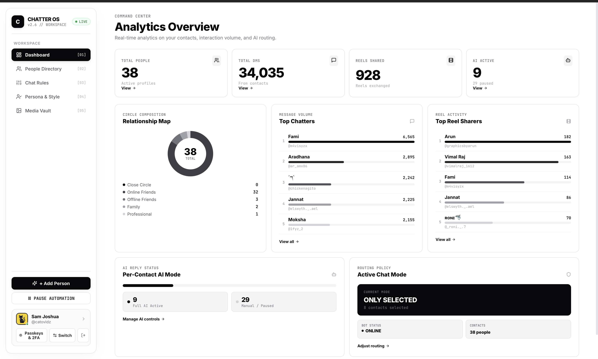

# Chatter OS — Instagram DMs, answered in your own voice

Chatter OS connects to an Instagram professional account and replies to DMs the way the owner
really texts. It reads the owner's own past messages and each person's chat history, keeps a
memory per contact, and checks every draft before it goes out. It's multi-tenant: every account
has its own data, voice and settings.

Two account types:
- **Personal**: replies in the owner's voice (slang, Tanglish, length, emoji), starts check-ins
  when chats go quiet, remembers people and what matters to them.
- **Business**: brand voice grounded in the business's own documents, with rules for hours,
  escalations and refunds, lead and booking capture, and human handoff.



---

## How a reply is made

```mermaid
flowchart TD
    IG([Contact sends a DM]) -->|webhook, HMAC-SHA256 checked| WH[server.js /webhook]
    WH --> Echo{Owner's own message?}
    Echo -->|yes: an echo| Own[Saved as the owner's message\norigin = human / human_after_draft]
    Own --> Cancel[Cancels any AI reply being written\nand learns from it if a draft was ready]
    Echo -->|no| Tenant[Find the account it belongs to]
    Tenant --> Voice[Voice note? Transcribe it\n(transcribeService)]
    Voice --> Debounce[Wait 1 s to group quick messages]
    Debounce --> Rules{Should the AI reply?\nglobal switch, chat mode, per person}
    Rules -->|no| Stop[Learn from it, no reply]
    Rules -->|yes| Context

    subgraph Context [Context, fetched in parallel]
      C1[Closeness: how much personal\ninfo this person may get]
      C2[Memory document about them]
      C3[Owner's real voice: past exchanges\nwith them + how they answered similar messages]
      C4[Learned rules from takeovers]
      C5[Documents (RAG), people map,\nshared media, reminders]
    end

    Context --> Gen[Azure OpenAI writes the reply\nTOP_MODEL, fallback model]
    Gen --> Repeat[Repeat guard: rewrite if it\nalmost repeats an earlier reply]
    Repeat --> Check[Voice check\nrules + judge]
    Check --> Human[Human pacing: typing delay,\nsplit into bubbles]
    Human --> Last{Owner took over meanwhile?}
    Last -->|yes| Learn[Draft dropped, takeover learned]
    Last -->|no| Send[Sent via Instagram Graph API\norigin = ai_auto]
```

### Voice check (`services/voiceCheck.js`)
Every AI draft is checked before it is sent:
1. **Rules** (instant): bot phrases like "just checking in" or "hope you're doing well", lines far
   longer than the owner writes, full stops or capitals the owner never uses. A failing draft is
   rewritten once, and the rewrite is used only if it's better.
2. **Judge** (fast model): scores 0-100 how much the draft sounds like the owner, compared with
   their real messages.

It runs by itself; nobody has to label anything:
- **Automatic comparison** (`services/styleCompare.js`): the owner's own typed messages from the
  last 30 days (every chat, AI on or off, including when they reply in between) are compared with
  the AI's replies: length, Tanglish, emoji, lowercase, full stops, questions, favourite words. Each
  difference becomes a rule in every reply and check-in prompt ("keep it short, about 4 words, like
  you"), refreshed every 6 hours.
- **Checker self-test** (`services/voiceAudit.js`): once a day the judge scores a sample of the
  owner's real messages (ground truth: they must pass) and of the AI's. Small judges are unreliable
  on short chat style (see `reports/`), so it may rewrite replies for that account only when it
  passes 85%+ of the owner's real messages and scores the AI clearly lower; otherwise it only
  watches (shadow).
- The **Voice Check** page shows the summary, the self-test and the rules learned from takeovers.
  Rating single replies by hand is optional.

| Setting | Effect |
| --- | --- |
| unset (default) | automatic: shadow until the daily self-test trusts the checker for that account, then enforce |
| `VOICE_CHECK=shadow` | rules fix drafts; the judge only logs |
| `VOICE_CHECK=enforce` | a low judge score also triggers the rewrite |
| `VOICE_CHECK_ENFORCE_PERCENT=10` | enforce for a stable 10% of accounts, shadow for the rest |
| `VOICE_CHECK_THRESHOLD=65` | judge pass mark |
| `VOICE_CHECK=off` | nothing runs |
| `VOICE_CHECK_AUTO=off` | never switch to enforce by the self-test |

Each check is saved (`VoiceCheckLog`, 60 days) and attached to the reply's Langfuse trace:
status, mode, score, judge time, detected language.

### Safety rules on every reply
- Shared writing rules (`services/replyStyle.js`) for every prompt: no bot phrases, and **never
  claim something that did not happen** ("already sent you", "check above") or invent a link,
  account or number; if it isn't known, say it will be sent later. Personal replies and check-ins
  may use the owner's Tanglish and emoji (at their real rate); business replies stay plain English.
- No agreeing for the owner: a reply that commits the owner to something is replaced by a holding
  line before sending (the Voice Check page shows what was really sent).
- Links: asking for a GitHub, LinkedIn, portfolio, resume or website searches the owner's
  documents for that link directly (`ragService.linkAsked`), not just by matching words.

### Learning engine (background)
- **Only the owner's own typing teaches the AI.** Every message records who wrote it
  (`Message.origin`: `contact`, `human`, `human_after_draft`, `ai_auto`, `ai_checkin`,
  `ai_reminder`). AI messages are never used as the owner's voice.
- **Takeovers** (`services/correctionLearning.js`): when the owner types while the AI had a reply
  ready, the dropped draft and the owner's message are compared. A real style difference becomes a
  candidate rule; it's used in replies only after 3 takeovers agree and none contradict it.
  Rules can be seen and removed on the Voice Check page.
- **Per-person memory** (`memoryIndexService`): real messages (never the AI's) are grouped into
  chat moments, summarised, and folded into one memory document per person, with a brain score
  and the bond read from the chats.
- **Memory agent** (`memoryAgent`): every 30 minutes it repairs People data (health check),
  merges duplicate facts, and turns real doubts into questions for the owner. Answering a question
  applies the change at once (through the "Fix with AI" engine) and shows what changed.
- **Quiz**: the owner answers real and AI-written messages from their people, and a "How you check
  in" section. Answers become persona fields and check-in examples.
- **Priorities and closeness**: who's top / normal / not important is ranked automatically and
  can be reordered by dragging. The closeness score decides how much personal information a reply
  may share; the owner's own labels always win over what the AI read from the chats.

### Check-ins (`services/checkInService.js`)
When a chat goes quiet, the AI texts first, for everyone the AI is on for or only picked people.
It copies how the owner really opens chats with that person (their greeting and nickname, read
from their past messages and quiz answers). Only inside Instagram's 24-hour window, never twice
without an answer, with a daily cap.

### Tagging people
In any answer box (AI questions, "Something wrong?", Fix with AI, Add / Update person), typing
`@` lets you pick one of your people. The server turns `@handle` into "Name (@handle)"
(`lib/mentions.js`) so the AI links the right person.

---

## Repository layout

```
server.js                 Express app: webhook, reply pipeline, most API routes, schedulers
routes/                   auth (login, passkeys, Instagram OAuth), analytics, knowledge (RAG),
                          workspace features, AI provider settings, alerts, voice (Voice Check)
services/
  azureOpenAI.js          reply, check-in, interview and extraction prompts; model fallback
  voiceService.js         owner's real voice: fingerprint, past exchanges, similar answers, Tanglish
  voiceCheck.js           "sounds like you" check (rules + judge, shadow / enforce, logging)
  correctionLearning.js   rules learned from takeovers
  checkInService.js       AI-started check-ins; checkInVoice.js: the owner's real openers
  memoryIndexService.js   per-person memory documents; memoryAgent.js: health check and doubts
  quizService.js          quiz; quizRealItems.js: real + AI-written questions
  closeness.js            closeness score and privacy level
  transcribeService.js    voice notes to text
  repeatGuard.js, humanizeService.js, replyStyle.js   human-looking output
  celRuleEngine.js, ragService.js, analyticsService.js business rules, documents, leads
  llmAdapter.js           bring-your-own model (OpenAI, Anthropic, Groq, Ollama, MCP)
  langfuse.js             tracing for every AI call
models/                   Mongoose schemas (Message, UserMemory, SocialGraph, PersonMemory,
                          PersonaConfig, VoiceCheckLog, StylePreference, QuizSession, ...)
lib/                      small shared helpers (reply policy, security checks, mentions)
tests/                    node:test unit tests (npm test)
frontend/                 Next.js app (App Router): Home, People, Chat Rules, Persona, Quiz,
                          Voice Check, Documents, Media Vault, admin pages
reports/, research_notes/ local research (not in git)
```

## Stack

| Layer | Used |
| --- | --- |
| Backend | Node.js 18+, Express 5, Mongoose 9 (MongoDB Atlas), ioredis |
| Frontend | Next.js 14 (App Router), React 18, Framer Motion, CSS |
| AI | Azure OpenAI: `TOP_MODEL` for every reply (code default `gpt-5.6-luna`; production sets it on Render, currently `gpt-4o`), `FALLBACK_MODEL`, `FAST_MODEL` for judges, a speech-to-text deployment for voice notes; optional bring-your-own models |
| Tracing | Langfuse (OpenTelemetry) |
| Rules | Google CEL (`@marcbachmann/cel-js`) |
| Email | Brevo / Resend HTTPS APIs |
| Auth | JWT, bcrypt, passkeys (`@simplewebauthn/server`), TOTP |
| Hosting | Backend on Render, frontend on Vercel |

---

## Running it locally

```bash
npm install
cd frontend && npm install && cd ..
cp .env.example .env            # fill it in (see below)
```

```bash
# Backend (set PORT=5001 in .env so it doesn't clash with Next.js)
npm start

# Frontend, in another terminal (frontend/.env.local: NEXT_PUBLIC_API_URL=http://localhost:5001)
cd frontend && npm run dev      # http://localhost:3000
```

Tests: `npm test` (all backend logic: reply rules, voice check, learning, quiz, check-ins,
closeness, security).

### Environment
Required: `MONGODB_URI`, `JWT_SECRET`, `ENCRYPTION_KEY`, `AZURE_OPENAI_ENDPOINT`,
`AZURE_OPENAI_API_KEY`, `AZURE_OPENAI_API_VERSION`, `META_APP_ID`, `META_APP_SECRET`,
`INSTAGRAM_APP_ID`, `INSTAGRAM_APP_SECRET`, `WEBHOOK_VERIFY_TOKEN`.

Models: `TOP_MODEL`, `FALLBACK_MODEL`, `FAST_MODEL`, `MEMORY_MODEL`,
`AZURE_OPENAI_TRANSCRIBE_DEPLOYMENT` (if unset, `gpt-4o-mini-transcribe`, `gpt-4o-transcribe`,
`whisper` and `whisper-1` are tried; with none deployed, voice notes get a "can't listen right now"
reply).

Voice check: `VOICE_CHECK`, `VOICE_CHECK_ENFORCE_PERCENT`, `VOICE_CHECK_THRESHOLD`.

Optional: `REDIS_URL`, `LANGFUSE_*`, `BREVO_API_KEY` / `RESEND_API_KEY`, `GIPHY_API_KEY`,
`UNSPLASH_ACCESS_KEY`. See `.env.example` for the full list.

---

## Deploying

- Push to `main`: Vercel builds the frontend and Render builds the backend automatically.
- `main` is protected: no force pushes, no deletion, changes come in through a pull request with
  one approval (the owner can push directly).
- Rollback: Vercel and Render can both roll back to an earlier deploy in seconds. A rollback turns
  their auto-deploy off; turn it back on afterwards.

## Security and isolation

- Webhooks are checked against `X-Hub-Signature-256` before anything runs.
- Every query is scoped to the signed-in owner (`ownerId`); one account can never read another's
  people, messages or memory.
- Instagram tokens and custom AI keys are encrypted at rest (AES-256-GCM).
- Messages from contacts are fenced off in prompts so they can't give the AI instructions.
- Deleting an account deletes everything it owns, including voice logs and learned rules.

## License
Private and proprietary. All rights reserved.
