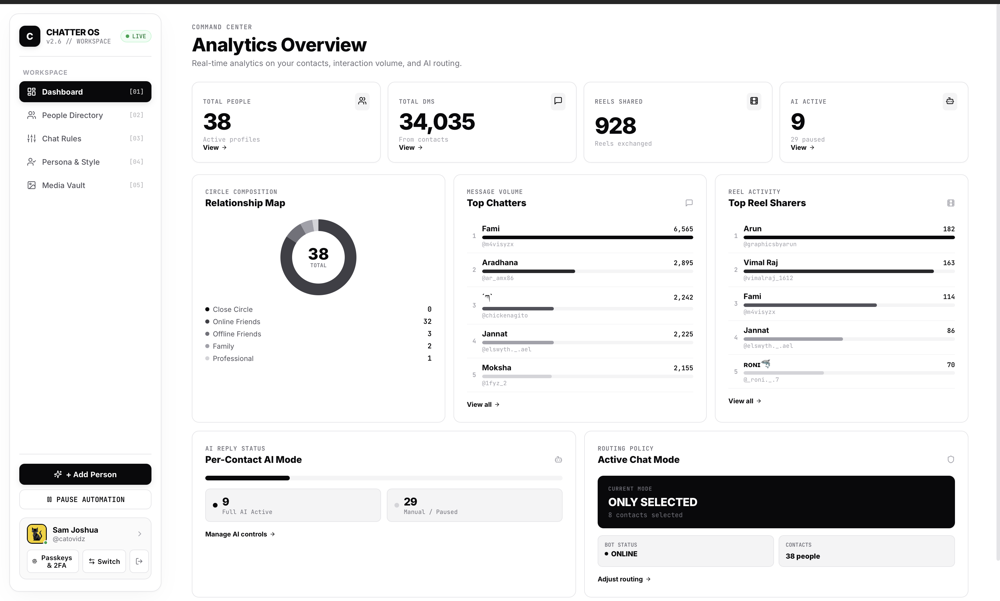
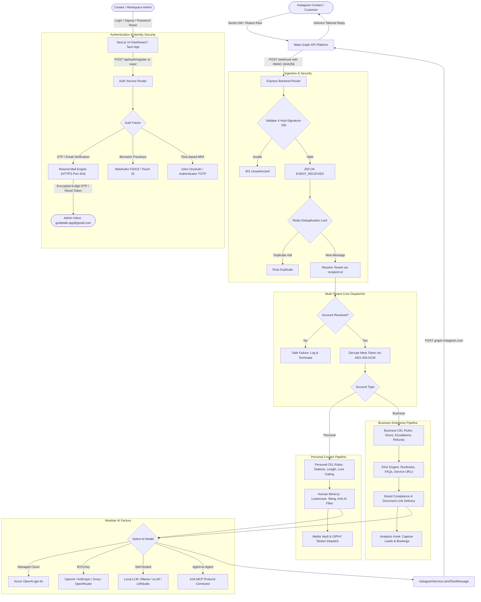

# Chatter AI — Multi-Tenant Instagram DM Intelligence & Auto-Reply Engine

[](https://developers.facebook.com)
[](https://nextjs.org)
[](https://expressjs.com)
[](https://mongodb.com)
[](https://azure.microsoft.com)
[](https://resend.com)
[](https://github.com/google/cel-spec)
[-24C8D8?logo=tauri&logoColor=white)](https://tauri.app)

Chatter AI is an autonomous, context-aware Instagram Direct Message platform engineered for **Personal Creators** and **Business Workspaces**. It blends deterministic policy enforcement via Google Common Expression Language (CEL), dynamic Retrieval-Augmented Generation (RAG) for enterprise runbooks, authentic human-mimicry styling for creators, and seamless OAuth connection through Meta's Graph API.

---

## 📸 Live Dashboard Preview



---

## 🏛️ System Architecture Overview



---

## 🚀 Key Platform Features

### 1. Personal Creator Tier (Human Mimicry & Social Connection)
- **Zero Robotic Tone:** Strictly eliminates robotic AI artifacts (*"How can I help you today?"*, *"As an AI model"*, *"Certainly!"*). Texting mimics real smartphone habits (all lowercase, no stiff periods, relaxed abbreviations like `rn`, `tbh`, `fr`, `ngl`).
- **Interactive Reel Reactions:** Automatically responds to shared Reels and Posts with contextual emoji reactions (e.g. laughing reaction `😂`), animated GIPHY stickers, or meme image drops from the Media Vault.
- **Dialect & Slang Adaptation:** Evaluates incoming language phonetics (e.g., Tanglish, Hinglish, Spanglish) and mirrors the user's conversational energy naturally.
- **Anti-Dossier Lore Gating:** Remembers personal details (birthdays, hobbies, life events) in MongoDB without awkwardly reciting facts out of context.

### 2. Business Workspace Tier (RAG Knowledge & Conversion Engine)
- **Grounded Document RAG:** Businesses upload PDF runbooks, price lists, brochures, and support FAQs into the Document Vault. Customer inquiries receive precise, grounded responses with official download links.
- **Conversational Sales Analytics:**
  - **Lead Capture:** Automatically detects customer phone numbers, emails, and quote inquiries, logging them in real time to `models/Lead.js`.
  - **Booking Confirmations:** Tracks appointment scheduling agreements and Calendly link clicks in `models/Booking.js`.
- **Zero Stickers / Brand Prestige:** Media stickers, slang, and meme reactions are strictly disabled for business accounts.
- **Human Handoff Queue:** Automatically routes customer complaints or sensitive requests to human support staff via Slack/Zendesk webhooks or the dashboard inbox.

### 3. Modular AI Architecture (Managed, BYO-LLM, Local & MCP)
- **Managed Platform Model:** Default Azure OpenAI `gpt-4o` (`2024-08-01-preview`).
- **Bring Your Own Key (BYO-LLM):** Connect custom OpenAI (`gpt-4o-mini`), Anthropic (`claude-3-5-sonnet`), Groq (Llama 3 70B), or OpenRouter keys (encrypted at rest using AES-256-GCM).
- **Local Self-Hosted AI:** Point to local models via **Ollama** (`http://localhost:11434/v1`), **vLLM**, or **LM Studio** for complete privacy.
- **Agent-to-Agent (A2A) MCP Connectors:** Full Model Context Protocol (MCP) support to route Instagram events to external multi-agent systems (LangChain, CrewAI, n8n).

### 4. Cross-Platform Desktop Client (Tauri 2.0)
- **Native OS Compilations:**
  - **macOS Apple Silicon:** Native `.dmg` for Apple M1, M2, M3, and M4 processors (`aarch64-apple-darwin`).
  - **macOS Intel:** Native `.dmg` for x86_64 Intel Macs (`x86_64-apple-darwin`).
  - **Windows 64-bit & 32-bit:** Native `.msi` and `.exe` installers for Windows 10/11.
- **Native OS Push Notifications:** Background notifications via `@tauri-apps/plugin-notification` for urgent human handoffs, new leads, and booking alerts.
- **System Tray Mode:** Runs unobtrusively in the menu bar with status badges.

---

## 📂 Repository Structure

```
instagram/
├── start.md                  # Developer kickoff guide & onboarding instructions
├── checklist.md              # Phased implementation tracker & acceptance criteria
├── PLAN.md                   # Comprehensive architectural specification
├── project.md                # System audit & baseline inspection report
├── server.js                 # Express server, webhook receiver, dynamic tenant router
├── package.json              # Backend dependencies and run scripts
├── models/
│   ├── User.js               # Multi-tenant user schema, roles, encrypted IG tokens
│   ├── PersonaConfig.js      # AI persona directives, tone, CEL rule sets
│   ├── UserMemory.js         # Per-sender extracted facts, lore, relationship standings
│   ├── SocialGraph.js        # Interactive relationship network graph (scoped by ownerId)
│   ├── Message.js            # Message history between bot and external sender
│   ├── MediaVault.js         # Creator meme assets, GIFs, and sticker configurations
│   ├── KnowledgeDoc.js       # Business RAG document chunks, runbooks, service URLs
│   ├── Lead.js               # Conversational leads captured (phone, email, intent)
│   └── Booking.js            # Booking confirmations & reservation tracking
├── services/
│   ├── azureOpenAI.js        # Azure OpenAI gpt-4o chat completion engine
│   ├── llmAdapter.js         # Unified AI factory (Azure, BYO-LLM, Local Ollama, MCP)
│   ├── celRuleEngine.js      # Dual CEL rule engine (Personal vs. Business)
│   ├── ragService.js         # Business document chunking and retrieval
│   ├── analyticsService.js   # Lead extraction and booking intent parser
│   ├── cryptoService.js      # AES-256-GCM token & API key encryption at rest
│   ├── instagramService.js   # Meta Graph API sender, typing indicators, reactions
│   ├── memoryService.js      # Automated background fact and lore extraction
│   ├── socialGraphService.js # Relationship network queries
│   ├── authService.js        # Resend HTTPS API transactional mail, OTP verification, WebAuthn Passkeys
│   └── redisService.js       # Distributed deduplication locks and rate limiting
├── routes/
│   └── auth.js               # Auth, WebAuthn passkeys, Facebook Login for Business OAuth
└── frontend/                 # Next.js 14 App Router dashboard
    ├── app/
    │   ├── page.jsx          # Dynamic Dashboard (Creator metrics vs. Business KPIs)
    │   ├── download/page.jsx # Auto-detecting desktop download portal (macOS/Win)
    │   ├── admin/page.jsx    # Superadmin workspace inspector & token health radar
    │   ├── controls/page.jsx # Visual CEL chat rules, killswitches, routing modes
    │   ├── settings/page.jsx # Persona editor, BYO-LLM settings, IG connection
    │   ├── vault/page.jsx    # Creator Media Vault (Personal) / Document Vault (Business)
    │   └── context/
    │       └── AppContext.jsx # Global state management & real-time API client
    └── components/
        ├── Sidebar.jsx       # Dynamic role/tier-aware navigation drawer
        └── AuthGate.jsx      # Session & passkey route guard
```

---

## 🛠️ Technology Stack

| Layer | Technologies |
| :--- | :--- |
| **Backend Runtime** | Node.js (v18+) & Express 4.18.2 |
| **Frontend Framework** | Next.js 14.2.3 (App Router), React 18, TailwindCSS, Framer Motion |
| **Desktop Framework** | Tauri 2.0 (Rust core + WKWebView / WebView2) |
| **Database & Cache** | MongoDB Atlas (Mongoose 8.3.1), Upstash Redis (`ioredis`) |
| **AI Providers** | Azure OpenAI (`gpt-4o`), Custom OpenAI, Anthropic, Groq, Ollama, MCP |
| **Rule Engine** | Google Common Expression Language (`@marcbachmann/cel-js`) |
| **Email Delivery** | Resend REST API (HTTPS port 443 — immune to cloud SMTP port blocks) |
| **Security & Auth** | Resend API (HTTPS Port 443 OTPs), WebAuthn / Passkeys (`@simplewebauthn`), JWT, BCrypt, AES-256-GCM, HMAC-SHA256 |
| **External APIs** | Meta Instagram Graph API (v19.0 / v26.0), GIPHY API |

---

## 🔐 Security & Multi-Tenant Isolation

1. **Webhook Integrity:** All incoming POST events are verified against `X-Hub-Signature-256` using the Meta App Secret before processing.
2. **Dynamic Tenant Dispatch:** Incoming DMs are matched against `recipient.id` (`User.findOne({ 'instagram.accountId': recipientId })`).
3. **Safe Failure:** If an incoming message cannot be mapped to a registered tenant, it drops safely without executing replies. **The platform never falls back to admin credentials for external accounts.**
4. **Token Encryption at Rest:** Every Meta Page Access Token and custom AI API key is encrypted using AES-256-GCM before saving to MongoDB.
5. **Prompt Injection Guardrails:** User messages are isolated inside strict `<incoming_message>` XML boundaries to prevent prompt hijacking.
6. **Transactional Email Hardening:** Email OTPs and password resets utilize Resend's REST API over HTTPS (port 443) rather than raw SMTP (ports 25/465/587), guaranteeing 100% deliverability on cloud hosting providers like Render without connection timeouts.

---

## 🚦 Getting Started

### Prerequisites
- Node.js v18+ and npm
- Running MongoDB instance (Atlas or local)
- Running Redis instance (Upstash or local)
- Meta Developer Account with an active Instagram Professional account
- Azure OpenAI endpoint or custom OpenAI/Ollama API credentials
- Resend Account & API Key (for transactional OTP & password reset emails)

### Installation & Local Setup

1. **Clone the repository:**
   ```bash
   git clone https://github.com/samjoshuav/instagram.git
   cd instagram
   ```

2. **Install backend and frontend dependencies:**
   ```bash
   npm install
   cd frontend && npm install && cd ..
   ```

3. **Configure environment variables:**
   ```bash
   cp .env.example .env
   ```
   Fill in your credentials:
   - `MONGODB_URI`: MongoDB connection string.
   - `ENCRYPTION_KEY`: 32-byte secret for AES-256 token encryption.
   - `META_APP_ID` & `META_APP_SECRET`: Credentials from Meta App Dashboard.
   - `WEBHOOK_VERIFY_TOKEN`: Verification secret for webhook challenge.
   - `AZURE_OPENAI_ENDPOINT` & `AZURE_OPENAI_KEY`: Default AI provider credentials.
   - `RESEND_API_KEY`: Resend API key for instant OTP and verification email delivery.

4. **Start the development servers:**
   ```bash
   # Start Express backend (port 5001)
   npm run dev

   # In a separate terminal, start Next.js frontend (port 3000)
   cd frontend && npm run dev
   ```

5. **Access the dashboard:**
   Navigate to `http://localhost:3000` to register your account, connect Instagram, and configure your AI assistant.


## 📄 License
Private & Proprietary — All rights reserved.
