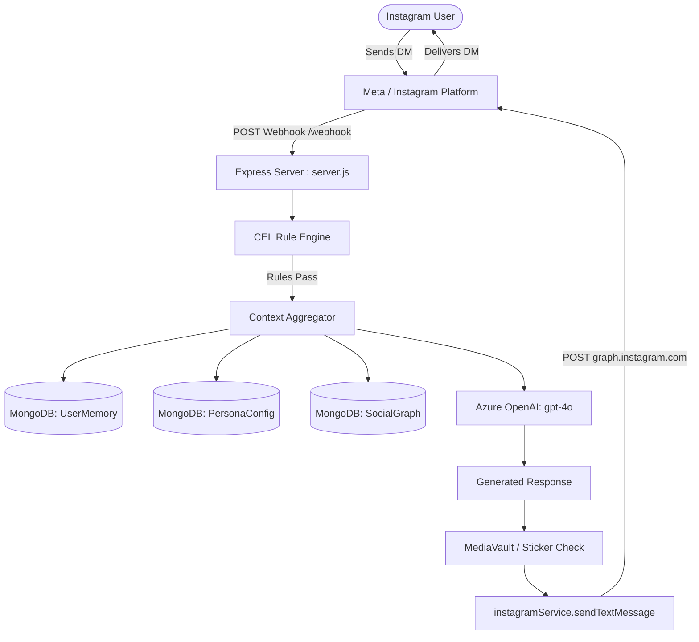
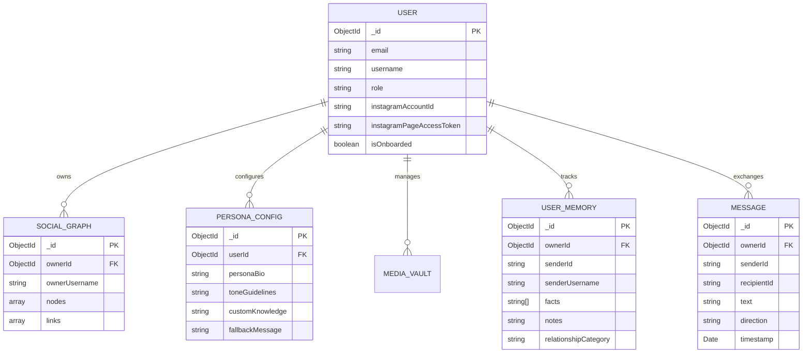
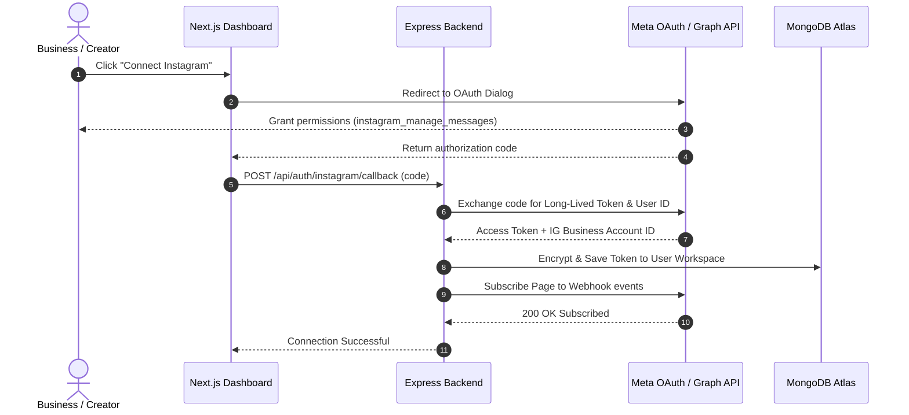

# Technical Inspection & Architecture Report: Instagram AI Auto-Reply Engine

This document provides a comprehensive technical audit of the Instagram AI auto-reply codebase. It details the existing architecture, data flow, security model, and provides an actionable blueprint for evolving the system into a multi-tenant SaaS platform.

---

## 1. Executive Summary

- **Core Capability:** The system functions as an autonomous, context-aware auto-reply bot for Instagram Direct Messages. Incoming Meta webhooks trigger automated context retrieval (user memories, relationship graphs, persona configurations, and sticker vaults) and invoke Azure OpenAI `gpt-4o` to generate grounded replies without robotic artifacts.
- **Current Architectural State:** Monolithic backend in Node.js/Express, hosted on Render, backed by MongoDB Atlas and Upstash/local Redis. The frontend is a Next.js 14 App Router dashboard hosted on Vercel.
- **Tenant Isolation Status:** The application originated as a single-tenant deployment centered on one global Instagram connection (`process.env.INSTAGRAM_PAGE_ACCESS_TOKEN` / `PersonaConfig`). Recent iterations introduced multi-user identity tables (`User.js` with roles `superadmin` and `user`), WebAuthn/Passkey support, and scoped tables like `SocialGraph` (`ownerId`). However, the messaging pipeline and Meta webhook routing remain tied to a single active token.
- **Readiness for Multi-User SaaS:** The core AI prompt composition and memory pipeline are modular and functional. Transitioning to a true multi-tenant SaaS requires replacing manual token entry with standard Meta OAuth (Facebook Login for Business / Instagram Graph API), building a webhook tenant-dispatch router keyed by Meta Account ID, and scoping all MongoDB collections by `workspaceId` or `userId`.

---

## 2. Verified Technology Stack and Project Structure

### Technology Stack
- **Backend Runtime:** Node.js (v18+) with Express 4.18.2 **[Verified: `package.json`]**
- **Frontend Framework:** Next.js 14.2.3 (App Router), React 18, TailwindCSS **[Verified: `frontend/package.json`]**
- **Database:** MongoDB via Mongoose 8.3.1 **[Verified: `package.json`]**
- **Caching & Rate Limiting:** Redis via `ioredis` (Upstash REST/socket or local fallback) **[Verified: `services/redisService.js`]**
- **AI Engine:** Azure OpenAI Service (`@openai/openai` v4.38.3 Azure client, `gpt-4o`) **[Verified: `services/azureOpenAI.js`]**
- **Authentication:** JWT (`jsonwebtoken`), BCrypt (`bcryptjs`), WebAuthn / Passkeys (`@simplewebauthn/server` and `@simplewebauthn/browser`), Nodemailer (SMTP OTP) **[Verified: `routes/auth.js`, `services/authService.js`]**
- **Rule Engine:** Google Common Expression Language (`cel-js`) **[Verified: `services/celRuleEngine.js`]**
- **Hosting Environments:**
  - Backend: Render (`https://instagram-ai-bot-64tf.onrender.com`) **[Verified: `frontend/app/context/AppContext.jsx`]**
  - Frontend: Vercel (`https://instagram-ebon-zeta.vercel.app`) **[Verified: live deployment traces]**

### Directory Structure **[Verified]**
```
instagram/
├── .env / .env.example              # Backend environment variables
├── server.js                        # Main Express server, webhooks, REST APIs, socket hooks
├── package.json                     # Backend dependencies and run scripts
├── models/
│   ├── User.js                      # User accounts, roles, credentials, passkeys, IG tokens
│   ├── PersonaConfig.js             # AI prompt persona, tone, rules, fallbacks, IG token
│   ├── UserMemory.js                # Per-sender extracted facts, notes, sentiment, dates
│   ├── SocialGraph.js               # Visual relationship nodes/links scoped by ownerId
│   ├── Message.js                   # Conversation log between bot and external sender
│   └── MediaVault.js                # Media assets, sticker vault, GIPHY configurations
├── services/
│   ├── azureOpenAI.js               # Azure OpenAI chat completions, prompt assembly
│   ├── instagramService.js          # Meta Graph API sender, typing indicators, profile fetch
│   ├── memoryService.js             # Automated fact extraction, vector-free DB retrieval
│   ├── socialGraphService.js        # Graph queries for relationship context
│   ├── authService.js               # OTP generation, SMTP mailer, passkey verification
│   ├── celRuleEngine.js             # Dynamic conditional evaluation for custom rules
│   ├── stickerService.js            # GIPHY & local media vault search and attachment
│   ├── redisService.js              # Rate limiting, distributed locks, session cache
│   └── reminderService.js           # Cron-based follow-up triggers
├── routes/
│   └── auth.js                      # Register, login, OTP verify, passkey, impersonation
└── frontend/
    ├── package.json
    ├── next.config.mjs
    ├── tailwind.config.js
    └── app/
        ├── layout.jsx               # Root HTML wrapper and global fonts
        ├── page.jsx                 # Main overview/status dashboard
        ├── context/
        │   └── AppContext.jsx       # Global client state, active user, API bridge
        ├── components/
        │   ├── AuthGate.jsx         # Client-side route protection & session check
        │   ├── LoginPage.jsx        # Login, registration, passkey authentication modals
        │   ├── OnboardingWizard.jsx # Multi-step account setup wizard
        │   └── Sidebar.jsx          # Role-aware navigation drawer
        ├── admin/page.jsx           # Superadmin user directory & workspace management
        ├── controls/page.jsx        # CEL chat rules, auto-reply triggers, killswitches
        ├── memories/page.jsx        # Sender memory directory, facts viewer, manual editor
        ├── relationships/page.jsx   # Interactive D3-style Social Graph viewer
        ├── settings/page.jsx        # Persona editor, system prompt tuning, IG credentials
        ├── simulator/page.jsx       # Sandboxed chat testing environment
        └── vault/page.jsx           # Media vault, reaction GIFs, and sticker manager
```

---

## 3. Existing Architecture and Component Connections

### Application Startup & Lifecycle
1. Backend boots through `server.js` executing `mongoose.connect(process.env.MONGODB_URI)`.
2. Static middlewares initialize: CORS, JSON parsing, URL encoding, and API rate limiting via Express/Redis.
3. Auxiliary services boot: `services/reminderService.js` starts background cron jobs; `services/redisService.js` establishes an Upstash/local connection.
4. Routes are bound:
   - `/api/auth/*` mounts to `routes/auth.js`.
   - Direct endpoints (`/api/persona`, `/api/memories`, `/api/rules`, `/api/social-graph`, `/api/media-vault`, `/webhook`) mount directly in `server.js`.
5. Frontend boots through Next.js 14 App Router, mounting `AppContext.jsx` to synchronize user profile, token status, and operational flags against `process.env.NEXT_PUBLIC_API_URL`.



---

## 4. Current Instagram Authorization and Messaging Flow

### Connection Method
- **Mechanism:** Direct token injection **[Verified: `server.js`, `models/PersonaConfig.js`]**. The system does not currently execute an automated OAuth handshake (neither Instagram Login nor Facebook Login for Business).
- **Token Type:** Long-lived Page Access Token or System User Access Token generated externally from the Meta Developer Dashboard **[Verified: Token structure `IGAAPY9...` / `EAA...` in configuration]**.
- **Storage Locations:**
  1. Primary: System environment variable `INSTAGRAM_PAGE_ACCESS_TOKEN` **[Verified: `.env`]**.
  2. Fallback: Database document `PersonaConfig.instagramPageAccessToken` **[Verified: `models/PersonaConfig.js`]**.
  3. Tenant profile: `User.instagramPageAccessToken` and `User.instagramAccountId` **[Verified: `models/User.js`]**.
- **Identifiers:** Account ID is stored in `INSTAGRAM_ACCOUNT_ID` or `PersonaConfig.instagramAccountId`.

### Webhook & Messaging Execution Flow
1. **Verification Request (`GET /webhook`):** Meta verifies the webhook using `hub.mode`, `hub.verify_token`, and `hub.challenge`. The server checks `hub.verify_token === process.env.WEBHOOK_VERIFY_TOKEN` and echoes the challenge back **[Verified: `server.js:L186-L196`]**.
2. **Event Ingestion (`POST /webhook`):**
   - Meta sends payload with `object: "instagram"`, containing `entry[].messaging[]`.
   - Server immediately returns HTTP 200 OK to prevent Meta delivery retries **[Verified: `server.js:L202`]**.
3. **Deduplication:** Server generates a cache key `msg_lock:${messageId}` in Redis with a 60-second TTL. If already processed, the duplicate event is dropped **[Verified: `server.js:L214-L223`]**.
4. **Typing Indicators:** Calls `instagramService.sendAction(senderId, 'typing_on')` using Graph API `v19.0` **[Verified: `services/instagramService.js:L64-L78`]**.
5. **Context Aggregation:**
   - Retrieves `UserMemory` where `senderId` matches the sender.
   - Retrieves `SocialGraph` nodes for relationship context.
   - Retrieves `PersonaConfig` for active prompt directives.
6. **AI Dispatch:** Calls `azureOpenAI.generateReply(senderId, incomingText, context)` **[Verified: `services/azureOpenAI.js`]**.
7. **Delivery:** `instagramService.sendTextMessage(senderId, replyText, recipientId)` fires a POST to `https://graph.instagram.com/v19.0/me/messages` **[Verified: `services/instagramService.js`]**.
8. **Memory Extraction:** Asynchronously calls `memoryService.extractAndSaveMemories()` to harvest new facts from the exchange without blocking the user response **[Verified: `server.js:L310-L325`]**.

---

## 5. AI and Knowledge-Base Architecture

### Provider & Credentials
- **Provider:** Azure OpenAI Service **[Verified: `services/azureOpenAI.js:L1-L18`]**.
- **Model Deployment:** `gpt-4o` (API version `2024-08-01-preview`).
- **Configuration Variables:** `AZURE_OPENAI_ENDPOINT`, `AZURE_OPENAI_KEY`, `AZURE_OPENAI_DEPLOYMENT_NAME`.

### Knowledge Base & Retrieval Pipeline
- **Vector Database / Embeddings:** Not currently implemented **[Verified: No Pinecone, Qdrant, Chroma, or pgvector dependencies in `package.json`]**.
- **Context Construction Technique:** Structured In-Memory Dynamic Prompt Injection. Context is compiled per-request from relational and document stores:
  - `PersonaConfig.personaBio`: Root identity definition.
  - `PersonaConfig.replyRules`: List of hard negative/positive constraints.
  - `PersonaConfig.customKnowledge`: Freeform text notes and instructions.
  - `UserMemory.facts` & `UserMemory.importantDates`: Array of known biographical data points about the sender.
  - `SocialGraph.nodes[].category`: Relationship standing (family, close friend, client).
  - `Message.find({ senderId })`: Last 10-20 turns of conversation history.
- **Tone Guidelines:** Enforces natural phrasing, forbids robotic placeholders, and restricts emoji overuse ("never use emoji in chat reply ppl find its ai, either reply with txt or only use three same emoji") **[Verified: `services/azureOpenAI.js:L78-L92`]**.

---

## 6. MongoDB Schema and Data Relationships



### Collection Inventory & Status
1. **`users` (`models/User.js`):**
   - Fields: `username`, `email`, `passwordHash`, `role` (`user` | `superadmin`), `authenticators` (Passkeys), `otpSecret`, `otpExpires`, `isEmailVerified`, `isOnboarded`, `instagramPageAccessToken`, `instagramAccountId`.
   - Multi-tenant readiness: Role-aware and supports workspace assignment.
2. **`personaconfigs` (`models/PersonaConfig.js`):**
   - Fields: `personaBio`, `aboutMe`, `toneGuidelines`, `characteristics`, `textingHabits`, `replyRules`, `customKnowledge`, `humanHandoffKeywords`, `instagramPageAccessToken`.
   - Multi-tenant readiness: Missing strict unique indexing on `userId`. Currently queries `PersonaConfig.findOne()` as a singleton in several routes **[Verified: `server.js:L360`]**.
3. **`usermemories` (`models/UserMemory.js`):**
   - Fields: `senderId`, `senderUsername`, `name`, `relationshipCategory`, `facts`, `importantDates`, `sentiment`, `notes`.
   - Multi-tenant readiness: Missing compound index on `(ownerId, senderId)`. In a shared environment, sender Instagram IDs could collide across accounts without explicit owner scoping.
4. **`socialgraphs` (`models/SocialGraph.js`):**
   - Fields: `ownerId` (ref: User), `ownerUsername`, `nodes` (`id`, `name`, `category`, `closeness`), `links` (`source`, `target`, `value`).
   - Multi-tenant readiness: Scoped to `ownerId` **[Verified: `models/SocialGraph.js:L28`]**.
5. **`messages` (`models/Message.js`):**
   - Fields: `senderId`, `recipientId`, `messageId`, `text`, `direction` (`incoming` | `outgoing`), `timestamp`.
   - Multi-tenant readiness: Missing `ownerId` foreign key.

---

## 7. Login and Registration Workflow

### Authentication Infrastructure
- **JWT & Passwordless Auth:** Implemented in `routes/auth.js` and `services/authService.js`.
- **Primary Auth Methods:**
  1. Standard email/password with BCrypt hashing (salt factor 10).
  2. FIDO2 / WebAuthn biometric passkeys (`@simplewebauthn/server`).
  3. One-Time Password (OTP) emailed via Nodemailer.
- **Role Hierarchy:** Supported roles are `user` and `superadmin`. Superadmins have permission to impersonate users (`/api/auth/impersonate`) and access global directories.

### New User Registration Path
1. **Initiation (`POST /api/auth/register`):** Creates user with `role: "user"` and generates a 6-digit numeric OTP valid for 10 minutes **[Verified: `routes/auth.js:L38-L56`]**.
2. **Verification (`POST /api/auth/verify-otp`):** Validates token, sets `isEmailVerified: true`, and returns signed JWT with 7-day expiration **[Verified: `routes/auth.js:L90-L108`]**.
3. **Onboarding (`POST /api/auth/onboarding`):** Captures profile metadata, persona configuration, and optional Instagram token **[Verified: `routes/auth.js:L180-L210`]**.

### Multi-Account Limitation **[Verified]**
When a newly registered user logs in, the backend can save their personal details to `User.js`. However, incoming messages from Meta are routed via `GET/POST /webhook` in `server.js`, which does not look up which user owns the incoming `recipient.id`. Outgoing replies fall back to `process.env.INSTAGRAM_PAGE_ACCESS_TOKEN`. Therefore, only the account tied to the server environment token is actively served by the webhook.

---

## 8. Meta App Status and Permissions

### Confirmed Settings **[Verified]**
- **Graph API Version:** `v19.0` **[Verified: `services/instagramService.js:L5`]**.
- **Required Permissions:**
  - `instagram_basic`
  - `instagram_manage_messages`
  - `pages_manage_metadata`
  - `pages_read_engagement`
- **Webhook Events:** Subscribed to `messages` and `messaging_postbacks` on the `instagram` webhook topic.

### Dashboard Verification Checklist **[Needs Verification]**
Because Meta Developer settings are managed outside the repository, verify the following in the Meta App Dashboard:
1. **App Mode:** Confirm whether the app is in *Development Mode* or *Live Mode*. In Development Mode, only registered App Testers, Admins, and Developers can message the bot.
2. **Access Level:** Confirm whether permissions have *Standard Access* (developers/testers only) or *Advanced Access* (public users).
3. **App Type:** Confirm the app is configured as a *Business* type to support Facebook Login for Business and page-scoped tokens.
4. **App Review Status:** Meta requires screencast demonstrations and verified privacy policy / data deletion URLs for `instagram_manage_messages` approval.

---

## 9. Current Limitations and Security Concerns

### Identified Vulnerabilities & Technical Debt
1. **Single-Tenant Webhook Routing:**
   - *Risk:* `server.js` processes all incoming webhook events using global credentials rather than resolving `entry[0].id` to a specific `User._id`.
   - *Status:* **[Verified]**.
2. **Plaintext Token Storage:**
   - *Risk:* `User.instagramPageAccessToken` and `PersonaConfig.instagramPageAccessToken` are stored as unencrypted text strings in MongoDB.
   - *Recommendation:* Encrypt tokens at rest using AES-256-GCM with a managed KMS key.
   - *Status:* **[Verified]**.
3. **Webhook Signature Validation:**
   - *Risk:* `server.js` lacks `X-Hub-Signature-256` HMAC validation on `POST /webhook`. Anyone who discovers the URL could forge inbound webhook events.
   - *Status:* **[Verified: `server.js:L200-L205`]**.
4. **Context Injection Surface:**
   - *Risk:* External user input from Instagram direct messages is interpolated directly into LLM prompts without boundary delimiters, allowing potential prompt injection.
   - *Status:* **[Verified: `services/azureOpenAI.js:L115-L135`]**.

---

## 10. Personal Assistant vs. Business SaaS Expansion

| Dimension | Personal AI Assistant | Business SaaS Assistant | Existing in Codebase |
| :--- | :--- | :--- | :--- |
| **Account Type** | Creator or Personal IG Professional | Business Professional Account | Single account hardcoded |
| **Knowledge Base** | Personal bio, habit rules, facts | Products, FAQs, refund runbooks, pricing | In-memory bio, facts, CEL rules |
| **Team Access** | 1 user owns 1 account | Multi-seat workspace (Admin, Agent, Viewer) | User & Superadmin roles exist |
| **Routing / Handoff** | Ignore or alert phone | Route to Zendesk, Slack, or human inbox | Keyword detection flags handoff |
| **Billing & Limits** | Low tier (e.g., 500 DMs/month) | Tiered pricing by seats, volume, and SLA | Not yet implemented |

---

## 11. Recommended Architecture and Implementation Roadmap



### Staged Implementation Plan

#### Phase 1: Security & Webhook Routing (Immediate)
- Implement `X-Hub-Signature-256` HMAC validation on all webhook payloads.
- Update `POST /webhook` to look up `User.findOne({ instagramAccountId: recipientId })` and load that user's specific context and token.
- Add AES-256 encryption at rest for stored access tokens.

#### Phase 2: Automated Meta OAuth Integration (MVP)
- Implement Facebook Login for Business OAuth flow (`/api/auth/instagram/connect` and `/api/auth/instagram/callback`).
- Automatically subscribe newly connected Instagram accounts to the app's webhooks via Graph API.
- Create an account disconnection and token revocation flow in the dashboard.

#### Phase 3: Tenant Isolation & Knowledge Scaling (SaaS Readiness)
- Add compound indexing on all collections (`workspaceId` + foreign keys).
- Isolate `UserMemory`, `PersonaConfig`, and `Message` queries by authenticated tenant.
- Replace unstructured prompt injection with a proper retrieval mechanism (e.g., vector embeddings for documents, products, and FAQs) when document size exceeds standard context limits.
- Integrate Stripe billing with tier limits enforced through Redis counters.

---

## 12. Unresolved Questions & External Clarifications

The following items should be verified with your consulting architecture team or in the Meta Developer Dashboard:

1. **Meta App Review Scope:** Has the Meta App already been submitted for App Review for `instagram_manage_messages` and `pages_manage_metadata`? If not, a multi-tenant product cannot onboard third-party accounts outside the development team.
2. **Account Eligibility Strategy:** Will your SaaS target Creator accounts, Business accounts, or both? Note that Instagram Graph API access requires accounts to be Professional (Creator or Business) and linked to a Facebook Page for business login.
3. **Data Residency & Privacy Compliance:** Does your target market (e.g., EU GDPR or US state privacy laws) require isolated databases per tenant, or is logical separation via `workspaceId` acceptable?
4. **Token Refresh Strategy:** Meta long-lived tokens expire after 60 days. An automated cron worker is required to invoke `GET /refresh_access_token` every 30-45 days to prevent auto-reply outages.

---

### Architectural Decisions Summary

Before expanding this project into a multi-user SaaS product, the three most important architectural decisions to make are:

1. **Webhook Routing Strategy:** Shift from reading global environment variables to looking up the target tenant dynamically from the incoming Meta account ID (`recipient.id`).
2. **Authentication Flow:** Replace manual token entry with a standardized Meta OAuth flow (Facebook Login for Business) to allow one-click onboarding.
3. **Data Scoping:** Enforce tenant isolation across all database models (`UserMemory`, `PersonaConfig`, `Message`, `SocialGraph`) using a consistent `workspaceId` or `userId` attribute.
